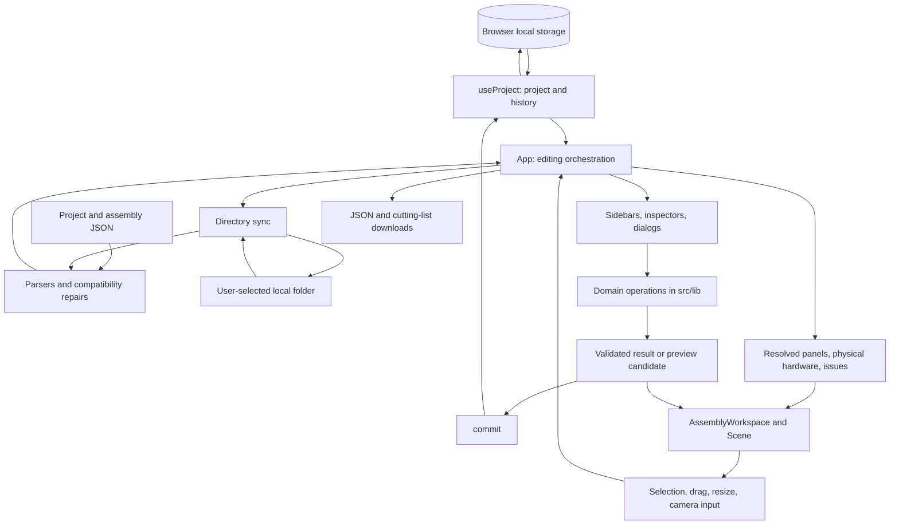

# Architecture overview

[Documentation index](README.md)

## Runtime and product boundary

Playwood is a single-page furniture design application. [index.html](../index.html) loads [src/main.tsx](../src/main.tsx), which mounts [App](../src/App.tsx) inside React Strict Mode and imports the base styles. There is one workspace at `/`, with dialogs and editor modes rather than a client-side router.

The runtime is entirely in the browser. The repository has no application server, authentication service, server database, or required environment variables. The current project is saved to local storage; portable project and assembly files use browser downloads/uploads or an explicitly chosen local folder through the File System Access API. IndexedDB remembers the folder handle, while permission, file selection, and disk autosave remain separate from project data. Local saves and remembered access belong to the browser origin, so another browser, hostname, or port has a separate save. The web manifest supports standalone launch, but there is no service worker or offline-cache implementation.

The main technologies and their roles are declared in [package.json](../package.json):

| Technology | Responsibility |
| --- | --- |
| React 19 and TypeScript | Workspace components, local state, typed model and commands |
| Three.js | Geometry, matrices, quaternions, collision primitives, meshes, and materials |
| React Three Fiber and Drei | React-managed WebGL scene, camera controls, helpers, and HTML overlays |
| Radix and local shadcn-style primitives | Accessible dialogs, tooltips, slots, and buttons |
| Tailwind CSS 4 and plain CSS | Shared tokens/utilities and component-specific workspace styles |
| Vite | Development server, TypeScript/JSX transformation, raw CAD imports, worker bundling, and production assets |
| Vitest and Playwright | Domain/geometry regression tests and browser workflows |

Use the lockfile for exact installed versions; the package manifest contains version ranges for most dependencies.

## Runtime data flow

This diagram groups responsibilities; it is not a strict module dependency graph. Several domain modules call each other. In particular, model parsing, assemblies, structural editing, and selection have cross-dependencies. Rendering helpers also live in both `src/lib` and `src/components`. Inspect imports before moving shared code, and avoid adding module-initialization work that depends on a cyclic import already being initialized.

## Source layout and ownership

| Location | Responsibility and useful entry points |
| --- | --- |
| [src/App.tsx](../src/App.tsx) | Composition root: selection, inspector modes, dialogs, command routing, import/export, global shortcuts, and feedback |
| [src/editor/](../src/editor/) | Application-specific state hooks, command adapters, and the inspector, workspace, sidebar, and dialog composition used by `App` |
| [src/hooks/](../src/hooks/) | React lifecycles around project history, assembly editing, clipboard, attachment previews, drag/resize transactions, and split feasibility |
| [src/lib/types.ts](../src/lib/types.ts) | Serializable domain contract shared by UI, operations, workers, parsers, and exports |
| [src/lib/model.ts](../src/lib/model.ts) | Panel creation, attachment transforms, world resolution, joint placement, project validation, parsing, starters, and CSV export |
| [src/lib/directory-sync.ts](../src/lib/directory-sync.ts), [src/hooks/use-directory-sync.ts](../src/hooks/use-directory-sync.ts) | Local folder handles and permissions, validated file discovery, conflict-checked writes, active file association, and opt-in disk autosave |
| [src/lib/assemblies.ts](../src/lib/assemblies.ts) | Reusable definitions, instances, ports, links, materialization, and shared-source changes |
| [src/lib/structure-edit.ts](../src/lib/structure-edit.ts) | Constraint-preserving movement, resize request compilation, legacy preference recovery, and candidate validation |
| [src/lib/resize-intent.ts](../src/lib/resize-intent.ts) | Transient resize targets, anchor/scope/hardware contracts, results, and source/session acceptance |
| [src/lib/resize-analysis.ts](../src/lib/resize-analysis.ts) | Shared resolved frames/protected contacts and optional immutable physical inspection |
| [src/lib/structural-solver.ts](../src/lib/structural-solver.ts) | Sparse weighted equality/bound kernel, row provenance, and numerical failure diagnostics |
| [src/lib/construction-objects.ts](../src/lib/construction-objects.ts), [object-geometry.ts](../src/lib/object-geometry.ts), [object-edit.ts](../src/lib/object-edit.ts) | Snapping and edge scaling, saved source-volume forest, immutable object commands, orthogonal transforms, and bounded Boolean surface evaluation |
| [src/hooks/use-construction-editor.ts](../src/hooks/use-construction-editor.ts), [use-object-preview.ts](../src/hooks/use-object-preview.ts), [use-object-gesture.ts](../src/hooks/use-object-gesture.ts) | Object selection/clipboard/drafts, gesture transactions, and cancellable worker previews, separate from panel editing |
| [src/lib/](../src/lib/) feature modules | Auto-connect, splitting, closure, rescaling, selection, clipboard, palette, outlines, snapping, example generation, and guide content |
| [src/components/](../src/components/) | DOM controls, lists, dialogs, SVG illustrations, R3F scene components, mesh/material helpers, and local CSS |
| [src/components/ui/](../src/components/ui/) | Editable button, dialog, and tooltip primitives; configuration is in [components.json](../components.json) |
| [resources/](../resources/) | Supplied CAD, PDF, and image references; selected resources are explicitly imported by application code |
| [public/](../public/) | Static brand assets, manifest, robots rules, and sitemap copied into production output |
| [tests/](../tests/) | Playwright browser workflows and an inspector-navigation helper |
| [scripts/](../scripts/) | Browser-based generation of committed brand PNGs |

The directory split is practical rather than an enforced package boundary. There is no separate backend, shared package, service layer, or global store framework.

## Workspace composition

`App` owns the committed project through `useProject` and passes derived data and callbacks to the UI. It resolves world-space panels, computes validation issues and bounds, builds the installed connector list, and determines which selection the inspector displays. Specialized hooks keep gesture and assembly workflows out of the JSX, but `App` remains the central coordinator.

The `src/editor` modules separate application wiring from reusable controls and domain operations. `use-editor-state.ts` holds transient UI state; `use-editor-selection.ts` derives panel and hardware selection details. The selection, attachment, and file command adapters receive explicit dependencies and call the existing domain APIs and `commit`. They are recreated from the current render, preserving functional commits and source-project checks when accepting previews. `editor-keyboard.ts` builds the guarded key handler; `App` owns its subscription. The `EditorInspector`, `EditorWorkspace`, `EditorSidebar`, and `EditorDialogs` components compose the controls in `src/components` without introducing another project store.

Context-menu availability and ordering live in [preview-menu-actions.ts](../src/components/preview-menu-actions.ts), with separate branches for connector selection, shared assembly editing, and panel construction tools. `App` supplies current selection/capabilities and command callbacks; the menu builder does not commit edits or own React state. Actions may carry a `submenu`; shortcut dispatch flattens nested actions with `flattenPreviewMenuActions`. One-click constraint entries come from [constraint-suggestions.ts](../src/lib/constraint-suggestions.ts), computed in `App` only while the menu is open.

[DesignConstraintsInspector](../src/components/DesignConstraintsInspector.tsx) owns the constraint draft, preview lifecycle, reference panel, and focus restoration. [DesignConstraintFields](../src/components/DesignConstraintFields.tsx) renders kind-specific controls and shared numeric requirement fields; it sends draft changes back to the inspector. Numeric labels and bounds are defined once per constraint kind.

The principal UI surfaces are:

- [ProjectHeader](../src/components/ProjectHeader.tsx): project name, save status, project actions, undo/redo, and guide access.
- [ProjectSidebar](../src/components/ProjectSidebar.tsx): library and assembly contents, with panels and connectors as separate list tabs.
- [GroupedList](../src/components/GroupedList.tsx), [PanelList](../src/components/PanelList.tsx), and [ConnectorList](../src/components/ConnectorList.tsx): ordering, selection, groups, and row actions. Organizational list groups are independent of reusable assemblies and physical connections.
- [AssemblyWorkspace](../src/components/AssemblyWorkspace.tsx): the scene and viewport controls, preview-mode presentation, and editing overlays.
- [InspectorSidebar](../src/components/InspectorSidebar.tsx) and specialized inspectors: single/multiple panels, physical connectors, attachment options, whole assembly instances, and source parts while editing a shared design.
- [ProjectDialogs](../src/components/ProjectDialogs.tsx): project creation/replacement, templates, panel creation, export, parts list, whole-creation transforms, and help.
- [DirectorySyncDialog](../src/components/DirectorySyncDialog.tsx): remembered local folder access, project opening/saving/duplication, folder autosave, and assembly file exchange.
- [ProjectStatus](../src/components/ProjectStatus.tsx): dimensions, counts, validation feedback, and shortcut/help access.

The workspace fills the viewport, with independently scrolling sidebars and dialogs. Narrow screens use drawers; realistic preview hides the sidebars. Changes to these surfaces must preserve keyboard focus and avoid outer-document scrolling. The browser suite checks desktop, compact, and phone layouts.

## Domain commands and derived representations

The serialized `Project` contains panels, connections, and optional assembly, palette, hardware-override, and list metadata. It does not contain Three.js objects, React components, DOM nodes, or GPU resources.

Several representations coexist for distinct reasons:

1. **Stored panels and connections** describe the editable construction. Driving connections determine child transforms.
2. **Resolved panels** come from `resolvePanels(project)` and describe current world placement. They are the basis for geometry-dependent UI, rendering, and many operations.
3. **Assembly definitions and instances** preserve reusable designs and per-instance configuration. Materialization keeps their physical panels and connections in the project consistent with that metadata.
4. **Physical connectors** come from [connector-selection.ts](../src/lib/connector-selection.ts). One connection can produce several pieces of hardware; per-piece overrides can alter or remove installed pieces while retaining the structural joint.
5. **Preview candidates** represent a prospective edit. The scene can show these without replacing the committed project or writing history on every pointer move.

This separation is why a panel's stored position or `connections.length` alone is often the wrong value for a feature. See [domain model and geometry](domain-model-and-geometry.md) for the invariants and [state and persistence](state-and-persistence.md) for transaction behavior.

## Rendering boundary

[Scene](../src/components/Scene.tsx) owns the R3F canvas and composes panels, physical connectors, camera controls, interaction handlers, guides, and optional room elements. Studio and realistic modes use the same scene implementation. The scene uses demand rendering, with explicit invalidation for changes that occur outside React renders.

Domain lengths are millimeters and rotations are Euler radians. Scene lengths are meters. Conversion happens in mesh, placement, camera, and interaction adapters; the project format stays in millimeters. Custom panel outlines use normalized panel-relative coordinates. These distinctions are covered in [rendering and interaction](rendering-and-interaction.md).

Three.js math is also used outside rendering. For example, the domain layer uses vectors, rotations, and bounding volumes to solve joints and constrained edits. A Three.js import therefore does not necessarily imply WebGL or a browser dependency.

## Examples, assemblies, and guides

The app ships editable content as code and local data rather than fetching templates from a service:

- [example-library.ts](../src/lib/example-library.ts) combines starter projects, CAD-derived examples, PDF-derived examples, the photo-inspired Diamond shelf, a six-level Cat tower, and a saved H-table workstation with monitor and speaker stands. The saved workstation is bundled from `resources/library-3d/user-projects`, cloned and validated with `parseProject` for each opening, preserving its source IDs and connector overrides. `createExampleProject` is the common construction entry point.
- [cad-examples.ts](../src/lib/cad-examples.ts), [pdf-examples.ts](../src/lib/pdf-examples.ts), [platform-examples.ts](../src/lib/platform-examples.ts), and [photo-examples.ts](../src/lib/photo-examples.ts) build model objects. They do not parse arbitrary uploaded CAD/PDF files at runtime.
- [cat-tower.ts](../src/lib/cat-tower.ts) loads the user-optimized [cat tower export](../resources/library-3d/user-projects/cat-tower.json) through `parseProject` on a fresh clone, preserving materials, colors, palette, IDs, and per-piece hardware overrides. The 2×2-bay tower uses 300×300 and 635×300 mm stock plus one 50×300 mm central reinforcing wall per tier. Each reinforcing wall connects to horizontal stock above and below without blocking the climbing openings. A full entry platform and six L-shaped horizontal surfaces bound six tiers; rotating missing corners form an internal climbing route, and paired omitted wall segments create floored lookouts. Saved connections are preserved without rerunning the automatic connection solver. Regression tests cover the route, support graph, CAD hardware clearance, and saved-project round trips.
- [connected-examples.ts](../src/lib/connected-examples.ts) adapts the eleven resource builds with thin accessories into connected 18 mm stock. It uses the grid and fitted-closure domain APIs, preserving source finishes while adding exposed edges for T/cross joints. Library cards and opened builds use the same adapted factories. Historical CAD/PDF factories remain the reference for conservative legacy insert repairs, so loading a saved example does not silently rebuild its topology.
- [synth-shelf.ts](../src/lib/synth-shelf.ts) loads the user-optimized [synth shelf project](../resources/library-3d/user-projects/three-tier-synth-shelf.json) through `parseProject` on a fresh clone. The catalog preview and opened build preserve the supplied panel identities, exact cuts, connections, finishes, and per-piece hardware adjustments. Regression tests cover source fidelity, independent copies, slope, stopper height, connectivity, hardware overlap, and save compatibility.
- [synth-storage-shelf.ts](../src/lib/synth-storage-shelf.ts) combines the optimized synth stand with a regular 2×2 `gridProject` cabinet. It replaces the former base with split roof panels and uses `autoConnect` to upgrade their outer corners into shared joints with the raised stand. Six saved equal-opening constraints keep cell widths and heights matched. Surviving source connections and hardware overrides remain intact; auto-connect also adds supplemental 90° hardware at the exposed front roof corners.
- [assembly-library.ts](../src/lib/assembly-library.ts) defines insertable modules and builds reusable definitions, ports, and editable parameters. Inserting a module is different from replacing the entire project with an example.
- [ExampleBrowser](../src/components/ExampleBrowser.tsx) presents the catalogs and previews their actual geometry. [library-preview.worker.ts](../src/lib/library-preview.worker.ts) constructs thumbnails and full replacement projects with the same factories. [example-project-preparation.ts](../src/lib/example-project-preparation.ts) retains at most eight unused built-in thumbnail projects; opening consumes a candidate once, so previously opened project objects are not reused and each factory retains its existing identity behavior. Cache misses use a dedicated cancellable worker, without waiting behind thumbnail jobs. Folder-file previews never enter this candidate cache. References in `resources/library-3d` document source provenance and simplifications.
- [build-guides.ts](../src/lib/build-guides.ts) registers the 45 illustrated techniques, with [workflow](../src/lib/build-guides-workflows.ts), [object](../src/lib/build-guides-objects.ts), [editing](../src/lib/build-guides-editing.ts), and [file](../src/lib/build-guides-files.ts) lesson modules. [build-guide-types.ts](../src/lib/build-guide-types.ts) defines their four-step structure and related-guide IDs.
- [guide-scenes.ts](../src/lib/guide-scenes.ts) caches example geometry, delegating object studies to [guide-object-scenes.ts](../src/lib/guide-object-scenes.ts), editing studies to [guide-editing-scenes.ts](../src/lib/guide-editing-scenes.ts), and file/order studies to [guide-file-scenes.ts](../src/lib/guide-file-scenes.ts). Guide furnishing choices use stable study identities so opening a fresh example does not randomly empty the illustration. Studies use real domain operations and catalogue quantities; connector previews can mark only the proposed piece as a ghost. The studies supply geometry for [GuidePreview](../src/components/GuidePreview.tsx), which produces SVG illustrations. [BuildGuide](../src/components/BuildGuide.tsx) is lazy-loaded by the dialog system; browsing a guide does not commit a project edit or add a WebGL canvas.

Examples are design studies with documented approximations. Rendering holes and custom outlines does not imply that every fabrication or hardware-clearance constraint is modeled. Preserve the limitations described in the user README and the domain documentation.

## Assets and deployment

[src/lib/connector-geometry.ts](../src/lib/connector-geometry.ts) imports `resources/connectors-3d/Connettori sharing.obj` with Vite's `?raw` suffix, parses it locally, normalizes each profile, and caches shared geometry. [src/components/connector-geometry.ts](../src/components/connector-geometry.ts) is a compatibility re-export. Connector rendering makes no external CAD request. Other files under `resources/` are references unless explicitly imported; that directory is not equivalent to `public/`.

Wood grain, metal detail, and room materials are generated procedurally. App-owned material prewarming uses a Vite-bundled worker and transfers losslessly packed pixels into the browser's material cache; the unchanged synchronous path supplies exact textures on early cache misses or worker failure. No texture image downloads or generated texture assets are required. See [rendering and interaction](rendering-and-interaction.md#panel-geometry-and-materials) for worker and source ownership. Brand images under `public/` are committed artifacts generated from the shared SVG mark by [generate-brand-assets.mjs](../scripts/generate-brand-assets.mjs).

`npm run build` runs TypeScript build checking and Vite, producing `dist/`. [vercel.json](../vercel.json) selects Vite, serves `dist`, adds response security headers, and sets year-long immutable caching for `/assets/*`. Public metadata and the configured canonical domain live in [index.html](../index.html) and `public/`; changing the hosting domain requires reviewing those together. Deployment has no application-server migration or environment-secret step.

For setup, verification, and asset regeneration commands, see [development and verification](development.md).

Selected-root cuboid/orthogonal-prism conversion uses `object-conversion.ts` for the validated append transaction and `object-conversion.worker.ts` for cancellable computation. The inspector imports its lightweight selection eligibility check from `construction-objects.ts`, keeping the conversion solvers out of the initial editor bundle. `ObjectConversionDialog` owns transient inputs and a separate preview Scene; App checks the original project identity during acceptance and selects the resulting ordinary panels.
