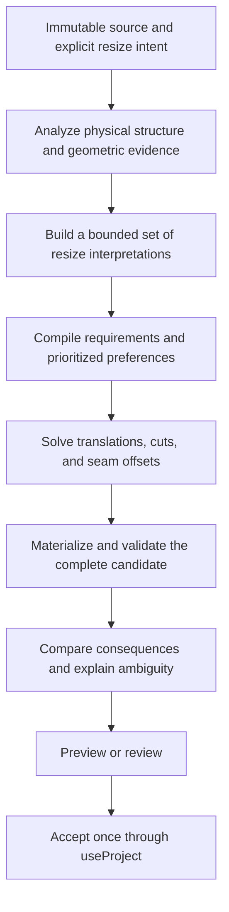

# Resize solver: infer intent before solving geometry

Status: stages 0 (benchmark), 1 (request/problem extraction), 2 (shadow planner), and 3 (ordinary numeric resize with review) implemented. Gesture and specialized-caller changes in stages 4–5 remain proposed. Analysis date: 11 November 2026. Source baseline: `5706d2b`. See the [stage 0 measurements and coverage](resize-solver-benchmark.md).

## Recommendation

Keep the existing physical model and fixed-rotation linear formulation. Introduce an explicit layer that decides **what the user is trying to preserve**, then asks the numerical solver to realize that interpretation. Evaluate a small number of meaningful interpretations when the evidence is ambiguous, including when today's resize already succeeds.

The central change is from “collect geometric coincidences as mandatory equations, solve, then loosen some after failure” to “separate requirements from evidence, choose a coherent resize interpretation, solve it, and explain its consequences.” A valid construction is necessary, but it does not establish that the resize matched the user's intent.

The first delivery should cover ordinary numeric panel resizing and connected panel-edge gestures. It should preserve local Shift-resize, selection stretching, project rescale, and assembly ownership through adapters, without expanding their semantics immediately. Repetition remains a separate operation because it changes topology.

This builds on [Constraints system improvements](constraints-system-improvements.md). Its implemented stock bounds, loose-cut protection, inferred-row provenance, reviewed alternatives, staged movement, saved relationships, and coordinated assembly edits are useful foundations. Reimplementing those six steps would not resolve the remaining intent problem.

## What the current solver actually does

The main implementation is [structure-edit.ts](../../src/lib/structure-edit.ts), especially `editComponent`, `editStructure`, and the public resize functions. [Domain documentation](../domain-model-and-geometry.md#structural-movement-and-resizing) describes the surrounding invariants.

1. Resolve panel world poses; detect surface contacts; join panels into solve components through physical connections, contacts, and enabled saved rules.
2. Give each panel three translations along its local axes and two cut-size changes. Add seam-offset variables. Rotations remain fixed; requested thickness changes are prescribed inputs.
3. Build affine joint equations, exact edit targets, saved requirements, stock bounds, inferred fit equations, and cut/placement preferences.
4. Minimize weighted change. The equality kernel solves `A W^-1 Aᵀ λ = b` with conjugate gradients; `solveWithBounds` adds bound projections and active-set solves.
5. On failure, retry without certain placement/cut preferences, then greedily restore feasible preferences.
6. Reconstruct connections and resolved poses, refit dependent outlines, adjust connector slides, and validate the candidate. Reviewed numeric alternatives can release an inferred relationship and repeat this process.

This is substantial constraint solving already. It supports closed structures, angled joints, stock limits, authored relationships, fitted inserts, and physical hardware. The deficiencies below mostly concern which problem it asks the numerical kernel to solve.

| Finding | Evidence in the current code | Consequence |
| --- | --- | --- |
| Numerical displacement is a proxy for intent. | `editComponent`, lines 221–270: local translation/cut weights `[1, 1, 64, 0.25, 0.25]`; seam offsets have weight 4. | Recutting can be numerically cheaper than translating a dependent part. Extra preservation rules compensate, but the objective still cannot identify an independent tray or a meaningful boundary. |
| Geometric inference changes feasibility abruptly. | `seamFits`, lines 243–259: overlap must exceed half the longer edge; setbacks must be below two thirds of overlap. Insert fits use an 80% occupancy threshold, lines 451–521. `inferred`, lines 281–287, adds exact rows. | Slightly different source dimensions can impose an entirely different resize behavior. These are decisions about intent disguised as geometry thresholds. |
| Preference recovery is procedural and greedy. | `solveChanges`, lines 726–780: release groups and re-add cuts in insertion order; boundary groups are ordered by distance. | Competing preferences are not compared by a documented semantic priority. Serialization-order sensitivity is a mechanism to test; this analysis has not reproduced a reordered-project failure. |
| Valid but surprising edits escape review. | `getResizeAlternatives`, lines 1178–1206, returns immediately if the default resize succeeds. It tries at most 16 single releases and returns the first four valid candidates. | Feasibility determines whether the user sees a choice. There is no impact ranking, combined interpretation, or comparison of successful outcomes. |
| The edit's meaning is distributed among callers. | Numeric resize uses a selected-average-center preference; edge resize supplies an exact center shift. [Project rescale](../../src/lib/project-rescale.ts) and [assembly parameters](../../src/lib/assembly-parameters.ts) recenter/ground after their solves. | A plain dimension patch omits important anchor, scope, and parameter semantics. These workflows should remain distinct, but their distinctions should become explicit inputs. |
| Some constraints only reject the completed optimum. | `editStructure`, lines 898–963: outline refit, hardware adjustment, support-overlap checks, final validation. [Build space](../../src/lib/design-constraint-edits.ts) is guarded after solving. | A rejected candidate does not prove every placement satisfying the requested interpretation is impossible. |
| Candidate validation differs by path. | Ordinary structural edits reject newly introduced validation errors; [model.ts](../../src/lib/model.ts) reports panel collisions as warnings. Alternatives and project rescale separately reject new panel collisions. | A stronger intent planner needs one deliberate acceptance policy instead of inheriting whichever wrapper invoked it. |
| Numerical failure and conflicting intent share diagnostics. | `solve` and `solveWithBounds` throw `SolverConflict` for failed residual checks/iteration exhaustion as well as conflicting equations. | “Cannot solve” is too easily presented as “your rules are incompatible.” |

### A concrete example of the remaining problem

[resize-alternatives.test.ts](../../src/lib/resize-alternatives.test.ts), test “retains protective defaults at the overlap threshold,” deliberately records this behavior for a centered corner joint:

| Initial parent cut | Requested parent cut | Initial child seam cut | Resulting child seam cut |
| --- | --- | --- | --- |
| 400 mm | 500 mm | 200 mm | 200 mm |
| 400 mm | 500 mm | 200.01 mm | 300.01 mm |

Both default solves succeed. The tiny input difference crosses the inference threshold, which makes both setbacks mandatory in the second case. No resize alternative is offered. This is a policy cliff, not floating-point error.

Geometry alone cannot tell whether the intended child is a fixed-size attached part, an insert that should preserve both clearances, or a proportional feature. The improvement is to represent these possibilities, use stronger evidence where available, and expose meaningful uncertainty. Moving the overlap threshold would merely move the cliff.

## Principles and behavior contracts

1. **Requirements and guesses have different authority.** Joints, stock/hardware limits, explicit targets and anchors, enabled saved rules, and ownership boundaries cannot be traded for a nicer result. Inferred setbacks, symmetry, cut families, and default placement remain hypotheses or preferences.
2. **Intent includes what stays fixed.** “Make this 500 mm” and “pull this edge 100 mm” are different requests. Never silently substitute one anchor for another to obtain feasibility.
3. **Propagation follows physical function.** A boundary spans an opening; a supported insert fits within one; an attached tray may travel rigidly. Driving-parent direction is a transform representation, not evidence that a parent matters more to the user.
4. **Unrelated geometry should stay unchanged.** Admit a cut as an adapting span only for an explicit target, an authored dependency, or a justified propagation path. A protective minimum is not permission to recut a loose peer.
5. **Ambiguity is an output.** Two materially different, similarly supported results should produce a choice. A low-level numerical tie resolved by array order is not user intent.
6. **A gesture has one stable interpretation.** Freeze its source geometry and inferred evidence. Pointer motion changes the target, not the identity of the compartment or anchor being edited.
7. **Judge predictions against outcomes.** Test unchanged cuts, boundary movement, openings, and hardware behavior. Passing validation or reproducing a previous implementation is insufficient.

Existing surface contacts serve as implicit supports. Preserve them as protected relationships in this work; do not quietly reclassify them as expendable merely because they were detected geometrically. Distinguishing incidental touch from necessary support requires a separate, explicit product decision.

## Proposed architecture



### 1. Carry the complete request through one transient contract

Introduce a `ResizeIntent` outside the saved `Project` schema. Suggested contents:

| Field | Meaning |
| --- | --- |
| Source/session | Immutable source project identity and session revision for stale-result checks. |
| Target | Panel cut, panel edge displacement, selected physical connector displacement, rigid section movement, measurement group, or assembly parameter values. Preserve simultaneous targets. |
| Anchor | Exact opposite edge/reference/instance supplied by the user, or a separately marked default centroid/floor/symmetry preference. Use panel-local references where appropriate. |
| Scope and mode | Local panel, connected structure, explicit stretch boundary, project measurement group, or assembly definition/instance. Identify forbidden regions and eligible adapting cuts. |
| Snap | Target entity/reference and requested coordinate, not only an already-rounded number. A snap cannot override a joint or authored rule. |
| Hardware policy | Preserve installed world positions for local resize; preserve current proportional rail distribution for connected resize. |
| Finalization | Nice-value behavior, whether the target may clamp during a gesture, and when consequences require review. |

Adapt `resizePanels`, `resizePanelEdge`, `resizePanelDimensions`, preview handles, and rescale/assembly callers to this contract before changing outcomes. Preserve today's numeric selection-average anchor initially; do not accidentally replace it with independent fixed centers for every selected panel.

Eventually compile rescale grounding/centering into the request instead of moving a solved candidate afterward. Overall minimum/maximum envelopes can change which panel supplies an extremum: handle that through explicit candidate boundary sets and final verification, rather than assuming a single globally affine envelope equation. Keep assembly-local and world-space anchors distinct.

### 2. Analyze three related structures, with provenance

Build an immutable `ResizeAnalysis` from `resolvePanels(project)`:

- **Physical structure:** complete joint membership, support branches, protected contacts, installed connector pieces, and assembly ownership. T/cross membership is a joint with several panels, not several unrelated pairs.
- **Geometric evidence:** flush/setback endpoints, opposing boundary faces, clear openings, centered inserts, matching neighboring compartments, and possible rigid attached sections. Record measured distances, tolerances, supporting panel/joint IDs, contradictory evidence, and supported geometry.
- **Propagation structure:** which cuts span which boundaries; which parts travel with a boundary; which dependent cuts must change when both ends move differently. Keep this separate from both the driving forest and relationships that only join solve components through a saved rule.

Start with connected seam ends, simple opposing faces, and orthogonal compartments in a construction-local frame. This includes a whole cabinet rotated in the scene. Keep the existing angled-joint equations, but do not infer arbitrary oblique compartments or use a rotated stock bounding box as proof of an opening. Fitted outline caps continue through their dedicated refit path.

Use edge/reference expressions as semantic primitives. For a fixed local axis, the end changes are `Δe− = Δc − Δsize/2` and `Δe+ = Δc + Δsize/2`. This directly expresses “keep the opposite edge,” “translate without recutting,” and “resize the span between these boundaries.” These expressions can compile to the current center/size variables; a wholesale variable rewrite is unnecessary.

Each inferred relationship needs more than today's kind/description: its geometric references, measured residual, evidence strength, originating detector, relevant scope, competing interpretations, and grouping with related evidence. Deduplicate shared evidence so encoding one physical T joint with several branches does not multiply its importance.

### 3. Infer coherent interpretations rather than individual row releases

For an ambiguous seam or compartment, generate only applicable interpretations:

| Interpretation | Supporting evidence | Expected behavior |
| --- | --- | --- |
| Preserve the attached part's cuts | Terminal attached section, no opposing boundary requiring a span; no controlling cut rule | Translate it as needed while its cuts stay fixed. A multi-panel tray can be a rigid dependent section, not just a terminal leaf. |
| Preserve one end alignment | Flush end, deliberate-looking small setback, or an explicit dragged reference | Follow that end; allow the remote overhang to change. |
| Preserve fitted clearances | Two opposing supported boundaries plus consistent small margins or repeated fitted inserts | Change the insert's cut with the opening, retaining its clearances. |
| Preserve compartment proportions | Saved opening ratio, or repeated topology and symmetry supporting a proposed interpretation | Redistribute clear openings after accounting for panel thickness and connector seats. Numeric cut equality alone is insufficient. |
| Expand the affected region | Local interpretation hits a stock/joint/rule limit; an adjacent boundary can move | Offer a larger scope with its outside-size and changed-cut consequences. |

An authored relationship is a requirement, not merely evidence for one row of this table. Equal numeric dimensions are intentional grouping in **Rescale creation**, but must not automatically group unrelated cuts in ordinary resizing.

Evidence strength initially means ordinal categories with documented features, not a probability. Strong cues include explicit controls and coherent boundary topology; isolated numerical coincidence is weak. Use continuous geometric residuals to compare soft evidence, rather than turning an occupancy percentage into a mandatory equation. Retain crisp thresholds for actual physical compatibility. Smooth scores alone cannot eliminate switches between distinct interpretations; ambiguity handling and gesture stability are still necessary.

Recognize rigid dependent sections through their attachment boundary and internal geometry. Do not make every connected component rigid. A candidate section must have a compatible common translation, preserve internal cuts/joints, and satisfy every external attachment and saved rule; otherwise subdivide it or decline the inference. This generalizes today's special cases for single-ended panels and angled stoppers.

Search coherent groups: for example, “keep all front edges of this compartment aligned” may change several rear-setback rows together. Avoid enumerating every subset of individual inferred rows. Start with the conservative interpretation and a few local alternatives; expand scope only when justified. An initial review-search cap of eight interpretations and 32 numerical solves is a proposed engineering budget to benchmark, not a guarantee of completeness or acceptable latency.

### 4. Make priorities and candidate ranking explicit

Separate two decisions: which semantic interpretation to try, and the best geometry within it.

**Within a candidate**, joints, explicit targets, authored rules, scope locks, and the chosen interpretation's defining relationships are hard. An interpretation is optional globally even when its defining equations are hard inside that candidate. Reject that candidate when those equations conflict; do not silently mutate its meaning.

Use a documented hierarchy for remaining preferences: preserve unrelated cuts first, preserve default boundary/reference placement next, preserve weaker geometric relationships next, and minimize residual translation/offset changes last. An explicit dragged anchor is already hard. A fitted insert cut explicitly identified as the adapting span is not an unrelated cut. Stronger evidence that would reverse a default belongs in a separately named interpretation, so its effect is visible.

Implement true priority levels, not enormous weight ratios. One tractable option is tiered linear optimization with absolute-value slack variables: minimize each tier's error, retain its optimum within a named tolerance, then solve the next tier; use a final quadratic displacement objective to settle remaining freedom. Prototype this against the existing kernel and a small trusted reference implementation before choosing a production backend. Simply freezing an arbitrary solution from a higher tier would incorrectly remove valid lower-tier choices.

**Across candidates**, compare an inspectable consequence vector:

1. Strength and coherence of the evidence supporting the interpretation, including contrary evidence.
2. Propagation beyond the directly affected region and changes to meaningful outside references.
3. Number of independent cut groups changed, followed by normalized cut changes; rigid dependent parts moving with their parent do not count as arbitrary scope expansion.
4. Preservation error for remaining inferred relationships.
5. Translation and seam-slide magnitude as tie breakers.

Start with a documented lexicographic comparator and evaluate it against labeled scenarios. Do not disguise these priorities in one unexplained weighted score. Compare geometric outcomes, deduplicate equivalent candidates, and retain materially different close contenders. Stable IDs may break a harmless presentation tie; they must not decide which bay gets recut. A truly symmetric semantic tie should retain both options or an explicitly symmetric interpretation.

The precise relative priority of locality versus pattern preservation needs evaluation. For example, changing one bay may be locally minimal while resizing all equal bays may better preserve a cabinet's design. The labeled benchmark must include both intended outcomes; the planner must return ambiguity where the available cues cannot distinguish them.

### 5. Separate feasibility, numerical reliability, and acceptance

Give every equation/bound provenance: physical joint, protected support, authored rule ID, target/anchor, scope, or inferred relationship. Return structured results such as `solved`, `infeasible`, `numerical-failure`, `candidate-invalid`, and `search-budget-exhausted`. Only report infeasibility when established by the selected algorithm; iteration exhaustion is not proof.

Keep numerical hardening behind the same problem representation:

- Report original-unit maximum equality residual, bound violation, active constraints, iteration count, and termination reason. Use separate named tolerances for algebra, contact, authored measurements, and outcome comparison; do not conflate the current `1e-5` solver residual with the 0.1 mm design-rule evaluation tolerance.
- Differentially check redundant loops, near-dependent rows, long bound chains, and imported rotation drift against a reference solver. The existing best-iterate fallback remains useful until an alternative demonstrates better reliability.
- Canonicalize equivalent input ordering, but also remove greedy policy dependence. Sorting alone makes an arbitrary policy repeatable; it does not make it meaningful.
- Cache fixed coefficients and warm-start active sets within a gesture, while retaining cold-solve equivalence checks. Performance work must not change which feasible candidate wins.

Bring constraints into the solve where their formulation is genuinely affine: rectangular-stock containment against fixed build-space faces, branch/joint seam overlap limits with fixed membership, and fixed-axis tangential support overlap. Match current hardware/removal semantics and imported-violation policy. Keep installed-piece interference, general collisions, and outline fitting in the final geometric validator unless a justified formulation is available.

After solving, run one complete candidate pipeline: materialize through existing domain/assembly APIs; refit outlines; update hardware; re-resolve; verify requested target and anchors again; validate rules, stock, supports, hardware, inserts, build space, and overlaps. For the new ordinary-resize planner, propose rejecting new rectangular-bound panel overlaps consistently across numeric and gesture paths. Roll this out as an explicit behavior change; do not silently redefine all movement commands.

The existing no-worsening guard for imported rule/build-space violations must remain. Existing affected-component reconciliation is stricter in places; preserve its behavior during extraction and decide any relaxation separately. For collisions and other issues tracked only by ID, do not claim no worsening from unchanged IDs alone: add a defensible numerical measure or conservatively hold affected pre-existing invalid geometry fixed. Never automatically repair unrelated imported problems during a resize.

On candidate invalidation, try the next applicable interpretation within budget. When possible, derive a blocking affine bound and re-solve the same interpretation. Collision avoidance may require discrete separation choices; keep those bounded and explicit. Exhausting candidates means no acceptable result was found, not that all possible resizes are mathematically impossible.

### 6. Explain and stabilize the interaction

Normal high-confidence edits should remain direct. Show a compact consequence summary during preview: requested/achieved size, fixed reference, adapting cuts, and limiting rule or hardware. Keep technical solver diagnostics in developer tooling.

When viable interpretations differ materially, offer a small review such as “Keep tray size,” “Keep both margins,” or “Keep front edge aligned,” with affected panels highlighted and cut/outside-size changes listed. Use the existing resize-review transaction rather than inventing a new commit path. Review should also be available for a successful-but-ambiguous numeric edit.

For gestures, analyze once at pointer-down and lock the chosen interpretation. Continue solving from the original project, as [preview-resize.ts](../../src/lib/preview-resize.ts) already does. On reaching a limit, retain the last valid preview and show the blocker for all handle kinds; currently only selection stretch retains the clamp reason. Offer a different interpretation deliberately, not by automatically jumping to another bay halfway through a drag. An unresolved ambiguous gesture can defer commitment to review on release; Escape cancels the entire transaction.

For a fixed interpretation, the linear feasible target interval can be characterized directly. Final collision/refit checks can make acceptance nonmonotonic, so do not treat today's 20-step bisection as proof of the globally largest feasible resize. Preserve the contiguous reachable preview from the source; use bounded continuation/bracketing for nonlinear checks and report the actual blocker.

Retain semantic snap targets through solving and verify whether they were reached. Nice-value finalization replays the same target/anchor/interpretation from the original snapshot and validates again. A rounded result must not silently choose another propagation policy.

Choices remain transient initially. A separate explicit action may save an existing supported dimension, setback, position, or opening-ratio rule. Do not save hidden inferred locks or infer enduring intent from an undo, a canceled preview, panel names, or unavailable construction history.

## Implementation sequence and completion gates

| Stage | Concrete delivery | Gate before proceeding |
| --- | --- | --- |
| 0. Establish the behavioral benchmark | Label current project fixtures and small synthetic cases with target, anchor, allowed adapting cuts, expected invariants, acceptable alternatives, and ambiguity. Record current outputs, validity, and timings. | Separate physical/compatibility regressions from intentional changes to inference policy. Include threshold and successful-but-surprising cases. |
| 1. Extract the problem and request | Add transient intent, analysis, row provenance, structured result, and diagnostic types; adapt existing public wrappers without changing policy. | Existing suites and adapter-equivalence tests pass; resolved results and hardware are unchanged within declared tolerances. |
| 2. Introduce a shadow intent planner | Implement seam/reference analysis, simple compartments, rigid dependent sections, and bounded semantic candidates for ordinary numeric resize. Keep old behavior active; compare locally in development/tests. | No invalid candidate; ranked results improve labeled examples and do not depend on array order. Log explanations and score components, not only success rates. |
| 3. Enable numeric resize with review | Add hierarchy-backed candidate solves, centralized acceptance, ranked/deduplicated review, and successful ambiguity detection. | Agreed benchmark gates below pass; explicit conflict, cancellation, stale source, undo/redo, export/reload, and narrow-layout checks pass. |
| 4. Enable stable gestures | Reuse frozen analysis, preserve snap/reference identity, surface all blockers, and handle review on release. Cache numerical work; offload larger searches if measurements justify it. | No policy switching within a gesture, no preview/history leaks, and acceptable measured latency. Numeric/gesture equivalence holds for matching intent. |
| 5. Consolidate other callers | Move project-rescale anchors into intent; integrate assembly parameters through existing ownership/materialization APIs; reuse proven analysis for movement and connector handles. | Parameter bindings, reference instances, source/override semantics, shared links, hardware IDs, and existing movement contracts remain intact. |

Stage 1 implementation: [`resize-intent.ts`](../../src/lib/resize-intent.ts) defines frozen transient requests, structured results, source/session acceptance, and optional inspection contracts. [`resize-analysis.ts`](../../src/lib/resize-analysis.ts) extracts the existing frames/contacts and exposes physical facts; [`structural-solver.ts`](../../src/lib/structural-solver.ts) holds the unchanged numerical kernel with failure diagnostics. `structure-edit.ts` retains the compiler, preference recovery, candidate validation, and public throwing wrappers. Numeric, edge/local, simultaneous dimensions, rim edges, and legacy reviewed releases go through the adapter. Preview, rescale, and assembly callers retain their workflows. Inspection captures initial rows with provenance, not final active constraints. Stage 2 below adds shadow semantic evidence/propagation. Hierarchy optimization, successful ambiguity review, gesture analysis caching, and centralized public acceptance remain for later stages. See [domain contracts](../domain-model-and-geometry.md#structural-movement-and-resizing).

Stage 1 verification (11 November 2026, source `af75e25`): a temporary direct comparison against the pre-extraction implementation matched all 17 corpus candidates, errors, and review alternatives exactly; the duplicate legacy module was then removed. The 33 new adapter/kernel tests cover simultaneous targets, average versus opposite-edge anchors, local hardware policy, source/session checks, ownership, physical analysis, provenance, weighted optima, bounds, and numerical-failure distinctions. Full Vitest: **1,961 passed, 3 failed**. The same three failures reproduce in an isolated pre-refactor checkout: the expected assembly-depth error text, hidden assembly drag corners, and Cat tower source-ID expectations. Build passes with the existing large-chunk warning. These pre-existing failures are not changes to the resize policy. Browser regression on a dedicated, prebundled Vite server: **382 passed, 31 failed**. All main edge/local resize, preview rescale, numeric rescale, selection stretch, and synth/storage browser scenarios passed; the mobile resize-review failure also reproduces in the pre-refactor checkout. The full browser suite is **not green**: other failures include mobile UI lookups, import/save polling, and rendering/export timeouts, and were not all baseline-audited. No unrelated UI/test expectations were changed to obtain a passing result. After the final diagnostic-only refinement, the full unit suite and build reran with the results above; isolated connector-resize and desktop-review browser checks both passed (including the synth-shelf import poll that timed out in the parallel run). Local documentation links and whitespace checks passed. React Doctor was not run because no React code changed. Initial browser attempts were discarded after identifying shared dependency-cache and lazy-optimization URL issues; the recorded complete run used a separate cache with existing dependencies prebundled.

Stage 2 implementation: [`resize-evidence.ts`](../../src/lib/resize-evidence.ts) recognizes measured seam ends, support margins, simple orthogonal openings (including rotated constructions), structural spans through complete T/cross membership, and candidate rigid sections. [`resize-planner.ts`](../../src/lib/resize-planner.ts) evaluates four coherent interpretations without activating them in the UI. Candidate-defining rows never enter legacy greedy recovery. The report retains distinct outcomes and explanations, orders inspectable lexicographic consequences, deduplicates equivalent geometry, and bounds shadow component solves at 32. Source identity and saved data remain unchanged. See the [implemented contracts and limitations](../domain-model-and-geometry.md#shadow-resize-planning); the stage 3 hierarchy is deliberately not claimed here.

Stage 2 evidence: the 20 new tests retain fixed/fitted choices on both sides of the overlap and occupancy thresholds, favor the nearer end across the setback threshold, retain both locked-child end choices, reject authored-target/stock conflicts, preserve unrelated equal cuts, and verify rotated openings and array-order invariance. The real synth/storage fixture produces one deduplicated valid outcome with unchanged tray/stopper cuts and common translations in all three dependent sections. A small-margin opposing-face fixture ranks the fitted candidate first. The numeric corpus report includes every attempt's status, candidate explanation, score components, cuts, and elapsed time. In one local warmed test run, simple cases took roughly 0.1–4 ms and the real synth/storage comparison roughly 23 ms; these are single-run observations, include the legacy comparison, and are not performance gates. Candidate budgets do not bound legacy comparison latency. The conservative ambiguity flag retains all distinct outcomes; calibrating close-contender thresholds and reconciling the corpus's differing ambiguity labels for geometrically identical seams remains stage 3 work.

Stage 2 verification: **1,981 unit tests passed, 3 failed**, with the same assembly-depth message, hidden assembly drag-corner, and Cat tower identity failures baseline-confirmed in stage 1. All 20 new shadow tests pass, and the 50 existing adapter/kernel/benchmark tests pass. Production build passes with the existing large-chunk warning. Browser tests and React Doctor were not rerun because this stage adds no UI wiring, interactions, persistence, or React changes.

Stage 3 implementation: ordinary inspector Width/Height commands now use `resizePanelsWithReview`, while low-level legacy wrappers, compound patches, gestures, rescale, and assemblies retain their policies. Candidate solves use genuine sequential least-squares priorities in a cached/reduced null space, preserving each tier's optimal residual vector rather than freezing a geometry. The final displacement objective remains quadratic. An independent enumerated two-variable reference and analytic optimal-face/bound-chain cases check the backend. `resize-candidate-validation.ts` centralizes source-bound final validation for planning, direct application, and review acceptance, including measured no-worsening checks for existing rectangular-bound overlaps. No imported issue is considered safe solely because its ID remains unchanged.

Normal single panels, equivalent structural-span outcomes, and decisive paired fits apply directly. Weak seams/support margins expose materially distinct choices, including successful-but-ambiguous requests. The existing review lists cut, position, and outside-size changes and highlights affected panels; cancellation does not commit, acceptance revalidates and commits once, and stale sources are rejected. Budget exhaustion requires explicit review of any valid partial search results. The unrelated equal-cut corpus case now retains the ambiguity of its identical seam; adding disconnected furniture cannot change inferred intent. Explicit equal-cut rules still adapt their dependent cuts.

Stage 3 limits: four coherent interpretations, no arbitrary per-bay combinations or wider-scope search, conservative unrelated-cut/rigid-section locks, fixed rotations, and existing outline/hardware validation limits. The overlap guard compares fixed-axis interval overlaps rather than exact intersected volume. Solver timings are local observations, not a claim that the proposed 200 ms/200-panel release gate has been met. Gesture continuity and worker/caching policy remain stage 4. Existing imported geometry can cause abstention when an affected issue has no defensible severity measure.

Stage 3 verification: all 14 numeric corpus labels match (2 direct, 10 review, 2 rejected), and every returned candidate preserves unlisted cuts. The 24 new priority/numeric tests cover the independent reference, hard authored targets, source guards, acceptance revalidation, equal-cut propagation, input validation, ID renaming, and measured overlap worsening. A local Node v25.5.0 / macOS arm64 run observed about 0.01–2.3 ms for small corpus cases and 158 ms for the 27-panel synth/storage command; these are single-run warm observations, not p95 or maximum-size guarantees. Production build passes with the existing large-chunk warning. All 6 desktop/narrow review workflows pass, including cancellation, focus restoration, apply, history, exported JSON, and reload; narrow screenshots were inspected. All 18 synth/storage and resize-handle workflows pass after the storage-depth regression explicitly chooses “Keep attached sizes” and import polls allow cold-render startup. The broader 32-test browser run initially had 27 passes and 5 failures: those two synth cases are resolved; the remaining three mobile constraint UI failures are the same failures recorded in stage 1 (empty-inspector visibility and two drawer-obstructed constraint workflows). No unrelated constraint UI code was changed. Browser coverage is focused, not a full-suite green claim. Final full Vitest: **2,005 passed, 3 failed (2,008 total)**; the failures remain the baseline-confirmed assembly-depth message, hidden assembly drag corners, and Cat tower source IDs. React Doctor ran after the React wiring and reports **64 findings (4 errors, 60 warnings)**. Its four error locations are unchanged gesture/scene/vacuum files; this patch introduces no effects there. New array-lookup findings were addressed with sets; the JSON round-trip test finding is intentional serialization coverage, not a production cloning path. No diagnostics were suppressed. Documentation links and `git diff --check` pass.

Implemented module boundaries are `resize-intent.ts` (request/result), `resize-analysis.ts` (physical facts), `resize-evidence.ts` (semantic evidence/section proposals), `resize-planner.ts` (interpretations/ranking), and `structural-solver.ts` (rows/numerics). `resize-shadow-contract.ts` carries the internal experimental compiler policy. Centralized numeric candidate validation is implemented in `resize-candidate-validation.ts`; `numeric-resize.ts` owns the inspector decision/review transaction. `structure-edit.ts` retains its public command APIs during migration.

The first useful vertical slice is a numeric 400→500 mm seam resize that recognizes both fixed-child and fitted-child interpretations, handles 200/200.01 mm source sizes consistently, and explains the chosen result or requests review. Include the blocked locked-child case to prove that ordinary ambiguity and hard conflict use the same architecture. Then add the attached angled tray as the second slice; it proves the design generalizes beyond replacing one threshold.

## Evaluation: test intent, not just solvability

Use existing real fixtures as regression evidence, not as the entire specification. Test names and assertions should state what the user meant to preserve. Existing threshold tests remain useful as old-policy characterization; update their expected behavior deliberately when the new policy is enabled.

| Scenario family | Required outcome/invariant |
| --- | --- |
| Single panel, numeric versus edge resize | Exact target; documented numeric center policy; exact opposite edge for an edge pull; no unrelated cut changes. |
| Threshold seams and inset shelves | Perturb across 50% overlap, setback, and 80% occupancy boundaries; no unexplained large cut jump. Ambiguity remains a valid expected result. |
| Shallow T/cross branch beside a deep panel | Near-end intent and independent depth preserved; complete joint branches and installed-piece fit retained. |
| Angled tray, stopper, and multi-panel attached section | Rigid travel when no spanning constraint demands recutting; an authored floor/dimension relationship can force the necessary span to change without distorting other branches. |
| Two-bay cabinet and 2×2 storage grid | Saved opening ratios remain exact; without rules, distinguish fixed-neighbor, symmetric, and equal-opening interpretations. Account for stock thickness and actual connector gaps. |
| Interior shelf and continuous sides/back | Local opening changes first where appropriate; continuous outside references remain meaningful; wider scope is explicit. |
| Equal numbers with unrelated topology | Ordinary resize does not couple cuts solely because values match; explicit common-dimension rescale still does. |
| Stock, build-space, support, and hardware limits | Bound cascades find feasible placements within the chosen interpretation; rejection identifies the blocker; removed connectors do not become installed hardware. |
| Fitted outlines, TROFAST, and existing violations | Dedicated fit checks remain authoritative; no unsupported fabrication claims; no silent loss of rules/support or worsening permitted baseline violations. |
| Linked assembly loops | Coordinated parameter targets remain atomic and source/instance metadata stays consistent; generic propagation cannot rewrite managed panels. |

Add metamorphic tests with clearly stated preconditions:

- Permute panel, connection, and constraint arrays; rename IDs consistently. Expect equivalent geometry and equivalent alternative sets, except presentation order.
- Re-encode an equivalent valid driving forest while preserving the same physical joints, poses, branch semantics, and hardware. Expect equivalent intent results; do not assume every arbitrary reroot is a valid representation.
- Rigidly transform the construction, edit direction, and anchors together. Expect equivalent results where no fixed world-floor/build-space rule breaks that symmetry. Transform coordinate rules only where the schema supports it.
- Repeat the same target from the same source; take many pointer samples versus one. Expect identical candidate geometry, source immutability, and one accepted edit.
- Return a gesture to zero. Expect the source exactly. Grow/shrink round trips should restore geometry within tolerance when interpretation, active bounds, rounding, and topology remain unchanged; do not assert unconditional reversibility across re-inference or discrete choices.
- Add redundant equivalent constraints or unrelated disconnected furniture. Expect no semantic effect when requirements and active scope remain the same.
- Sweep target values and tiny source perturbations; compare policy identity and geometry. Away from physical/active-set changes, expect continuity. At semantic transitions, require explicit ambiguity or a documented choice rather than a hidden discontinuity.
- Compare warm/cold solves and the production/reference numerical implementations. Verify original-unit residuals, not only output similarity.

Proposed release gates, to agree after measuring stage 0:

- **Correctness:** zero accepted violations of the defined hard requirements across the corpus and generated cases; all explicit target/anchor and transaction tests pass.
- **Intent:** at least 95% of labeled unambiguous cases choose an accepted first result; all labeled materially ambiguous cases expose an accepted alternative or explicitly report unresolved ambiguity. Report coverage and abstention separately so “always ask” cannot inflate quality.
- **Invariance:** all supported permutation/transform tests pass; no unexplained policy cliff in the threshold sweeps.
- **Responsiveness:** on a documented reference machine, target p95 warm preview solves under 16 ms for common builds up to 50 panels; target reviewed searches under 200 ms for ordinary cases. Measure 200-panel/400-connection projects separately. These are proposed budgets, not measured performance claims; use cancellation/worker results and the last valid preview when a larger search cannot fit the interactive budget.
- **Maintainability:** new failure reports identify a missing semantic relationship, invalid candidate, numerical issue, or unresolved ambiguity. They should not require adding another project-name or isolated dimension-threshold exception.

The labeled corpus should include intended edits collected from real users when available. Record acceptable alternatives, not a single arbitrary golden output. Keep a holdout set of project families so tuning on synth shelves and tables does not merely encode those fixtures. No backend, telemetry collection, or model training is needed for this initial plan.

## Compatibility and scope limits

Keep `Project.version: 1`, the existing storage key, and all current IDs. No persisted field is required for stages 0–4. Derived intent, explanations, caches, and previews belong outside the project. Any later saved semantic relationship requires a separate lifecycle design covering parser defaults, copying, assemblies, standalone exports, undo/redo, and reload.

All accepted edits still pass through `useProject`; cancellation leaves the committed construction untouched. Review acceptance checks source identity. Preserve immutable snapshots, grouped history, last valid previews, demand rendering, and worker cancellation/stale-result guards. Assembly definitions, instances, ports, bindings, and overrides remain authoritative.

This plan does not promise complete intent recovery from geometry, exhaustive feasible search, shape-aware collision checking, or fabrication safety. It also does not require an LLM or a full furniture classifier. Start with inspectable geometric evidence and a small hypothesis vocabulary; revisit learned ranking only if a representative labeled corpus shows that the deterministic policy is insufficient.

## Foundations and references

Constraint hierarchies provide a useful distinction between required relations and preferences at different strengths. The [Cassowary paper by Badros, Borning, and Stuckey](https://badros.com/greg/papers/cassowary-tochi.pdf) also distinguishes comparators and incremental edits. Apply those ideas to the problem interface and priority design; adopting Cassowary itself would change the objective and needs benchmarking rather than being assumed to solve furniture intent.

[iWIRES by Gal, Sorkine-Hornung, Mitra, and Cohen-Or](https://igl.ethz.ch/projects/iWires/index.php) demonstrates analyzing structural features and their relationships before editing a man-made shape. The proposed boundary/compartment analysis is an adaptation of that broad analyze-then-edit principle to Playwood's explicit panels and joints, not a claim that its mesh algorithm directly applies here.

The intent contract, candidate vocabulary, priority order, and rollout metrics above are proposals derived from this repository analysis, not externally validated guarantees.

## Verification performed for this analysis

Inspected the solver, public edit paths, preview limiting, rescale/assembly boundaries, validation, existing plan, relevant documentation, and regression coverage. The initial worktree was clean.

Ran:

```sh
npm test -- src/lib/structure-edit.test.ts src/lib/structure-resize-preservation.test.ts src/lib/structure-cut-preferences.test.ts src/lib/structure-design-constraints.test.ts src/lib/resize-alternatives.test.ts src/lib/h-table-resize.test.ts src/lib/connector-resize.test.ts src/lib/preview-resize.test.ts
```

Result: **8 test files, 159 tests passed**, using Node 25.5.0 and Vitest 4.1.12. This establishes the current baseline; it does not validate the proposed architecture or intent metrics. Documentation links/references and `git diff --check` were checked. No application code changed; build, React Doctor, and browser suites were not run for this documentation-only analysis.
