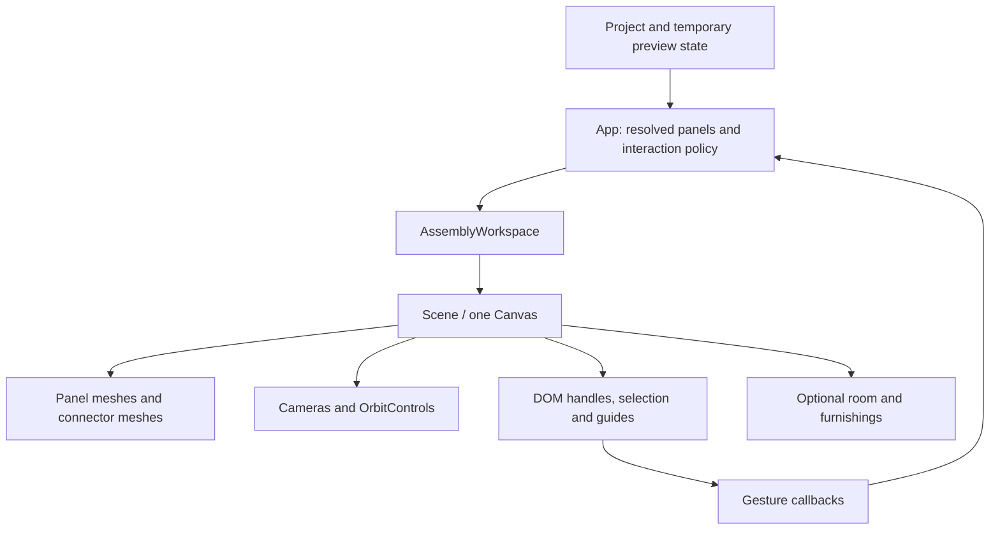

# Rendering and interaction

[Documentation index](README.md)

The editor combines a React DOM interface with one React Three Fiber viewport. Project geometry remains ordinary TypeScript data; the viewport receives resolved panels, connections, selection, and callbacks. It does not own the saved project. See [state and persistence](state-and-persistence.md) for commit and preview state, and [domain model and geometry](domain-model-and-geometry.md) for the construction rules behind the display.

## Component boundaries

| Area | Entry points | Responsibility |
| --- | --- | --- |
| Application composition | [`App.tsx`](../src/App.tsx) | Selects the active inspector, combines previews, decides which interactions are available, and routes callbacks to project operations. |
| Workspace chrome | [`AssemblyWorkspace.tsx`](../src/components/AssemblyWorkspace.tsx), [`ViewportControls.tsx`](../src/components/ViewportControls.tsx) | Studio/room mode, snapping controls, camera commands, pan mode, operation status, attachment notices, and optional furnishings. |
| Three.js scene | [`Scene.tsx`](../src/components/Scene.tsx) | Canvas, cameras, lights, panel meshes, connector meshes, selection highlights, dimensions, guides, and canvas gestures. |
| Inspectors | [`InspectorSidebar.tsx`](../src/components/InspectorSidebar.tsx), [`SinglePanelInspector.tsx`](../src/components/SinglePanelInspector.tsx), [`MultiPanelInspector.tsx`](../src/components/MultiPanelInspector.tsx), [`ConnectorInspector.tsx`](../src/components/ConnectorInspector.tsx), [`AssemblyInspector.tsx`](../src/components/AssemblyInspector.tsx) | DOM controls for editing the current selection. |
| Lists | [`PanelList.tsx`](../src/components/PanelList.tsx), [`ConnectorList.tsx`](../src/components/ConnectorList.tsx), [`GroupedList.tsx`](../src/components/GroupedList.tsx) | Selection, filtering, ordering, naming, visibility, and group interactions. |
| Dialogs and help | [`ProjectDialogs.tsx`](../src/components/ProjectDialogs.tsx), [`BuildGuide.tsx`](../src/components/BuildGuide.tsx), [`ExampleBrowser.tsx`](../src/components/ExampleBrowser.tsx) | Project flows, library browsing, parts/export dialogs, and the illustrated field guide. |

[`main.tsx`](../src/main.tsx) mounts the application under `React.StrictMode`. Global layout and theme rules live in [`index.css`](../src/index.css); feature styles are colocated under `src/components/`. Radix-backed dialog, tooltip, and button primitives live in [`components/ui/`](../src/components/ui/). Feature components also use native controls and disclosures. [`InspectorDisclosure`](../src/components/InspectorPrimitives.tsx) remembers expansion in an in-memory map and can defer mounting expensive content until first opened.

## From project data to a frame

`AssemblyWorkspace` removes panels and connections superseded by a preview before forwarding the base geometry. Ghost panels and connections are rendered separately, avoiding duplicate opaque originals under a replacement preview. Attachment candidates can also contribute to camera fitting without being drawn.

`Scene` creates a `Canvas` with shadows, `frameloop="demand"`, device pixel ratio limited to `[1, 2]`, antialiasing, and `preserveDrawingBuffer`. React changes, camera controls, and explicit `invalidate()` calls cause rendering; there is no deliberately continuous scene animation. Components using `useFrame` update screen projections when frames run. A WebGL fallback and `ViewportBoundary` show an error in the viewport if rendering cannot start, leaving the surrounding editor available.

### Coordinate boundary

Project lengths and positions use millimeters, and rotations use Euler radians. A panel's geometry is centered on its local XY plane, with thickness centered along local Z. World Y is vertical.

The scene converts project millimeters to meters with `0.001`. Panel geometry performs that conversion when constructed; panel and connector positions are converted when assigned to Three.js groups. Drag ray intersections work in meters and convert deltas back to millimeters before calling editing code. Rotation values pass through unchanged.

Room layout and `FurnishingPlacement` values already use meters. CAD connector geometry also returns meter-based vertices. Converting these again would shrink them by another factor of 1,000. Camera bounds, lighting, and dimension-line geometry use scene meters; dimension labels convert back to millimeters.

### Cameras and navigation

The `CameraController` in `Scene.tsx` uses perspective projection for the perspective view and orthographic projection for front, top, and right views. Room mode forces a perspective camera and uses its own field of view and orbit limits.

Camera fitting projects the corners of the visible geometry's bounds into the current camera basis. Room fitting additionally includes scale-reference objects. `fitSignal` requests a normal fit; `frameSignal` can reframe while preserving the current viewing direction. Fitting clears pending control damping first so previous pan inertia does not move the result afterward.

`OrbitControls` handles ordinary camera gestures: left-drag orbits in perspective unless Pan view is enabled, right-drag pans, and the middle button dollies. In orthographic views, left-drag pans. The controls support touch gestures and screen-space panning. Zoom commands adjust perspective camera distance or orthographic zoom within their limits.

Exploded view is a display transform: panel positions are pushed away from the bounds center. It does not write positions into the project, and connector meshes and overall dimensions are omitted in this view.

## Panel geometry and materials

[`makePanelGeometry`](../src/components/scene-geometry.ts) builds a `THREE.Shape` and extrudes it through the panel thickness. Rectangles, rounded corners, and custom outlines share this path. Custom-outline coordinates are transformed from top-left panel coordinates into the centered scene plane. Pegboard circles and rounded slots are actual holes in the extruded shape, with clearance checks that keep each complete opening inside the contour.

The geometry builder has a performance guard: if the candidate perforation grid exceeds 5,000 openings, it skips creating the openings rather than changing their pitch. It uses eight curve segments and no extrusion bevel. Face UVs retain physical meter scale so grain does not stretch when the board dimensions change.

`PanelMesh` memoizes geometry by its shape inputs, textures by material/coverage needs, and materials by finish settings. Its selection outline is a slightly expanded rectangular bounding box, even for a custom outline. The rendered custom contour therefore has more detail than this selection affordance.

[`wood-texture.ts`](../src/components/wood-texture.ts) generates deterministic wood texture data locally. Pixel sources are cached by material; each panel owns disposable texture wrappers referencing those sources. [`panel-materials.ts`](../src/components/panel-materials.ts) supplies separate face and edge materials. Finish coverage reduces grain color variation, bump, roughness variation, and birch plywood edge bands together. Painted material and full finish coverage avoid the wood maps. Ghost panels use translucent accent materials without grain or depth writes.

Panel geometry, outline geometry, texture wrappers, and materials have explicit effect cleanup. Preserve this ownership when adding a panel visual: rebuilding a geometry on every selection change is unnecessary, while disposing a shared cache entry can break other meshes.

## TROFAST geometry

[`scene-geometry.ts`](../src/components/scene-geometry.ts) cuts rounded rectangular holes for saved TROFAST inserts. [`TrofastMeshes.tsx`](../src/components/TrofastMeshes.tsx) renders the matching hollow tapered plastic boxes, wire mesh boxes, and divided trays in both Studio and Realistic preview, with shadow-receiving materials and product-specific colors. The render uses fixed real outer sizes from the catalogue; molded profiles, colors and cutout sizes are visual approximations.

[`trofast-geometry.ts`](../src/components/trofast-geometry.ts) caches immutable geometry for application lifetime. Instance materials use declarative React Three Fiber ownership; cached geometry is attached as a primitive and is not disposed per instance. There is no animation loop or network model dependency. Box mesh selection, context menus and box selection refer to the host panel. Camera fitting includes insert bounds. Auto furnish excludes panels with openings and treats hanging boxes as obstacles for other surfaces.

## Connector geometry and materials

[`ConnectorMeshes.tsx`](../src/components/ConnectorMeshes.tsx) gets each connection's allowed rail and clamp placements from [`connector-movement.ts`](../src/lib/connector-movement.ts). It derives physical connector IDs from the connection ID and clamp index, applies per-piece finish/removal/slide overrides, and renders each remaining piece. Connector selection is attached to the enclosing group so all CAD bodies belonging to one clamp identify the same part.

[`components/connector-geometry.ts`](../src/components/connector-geometry.ts) is a compatibility re-export; the implementation is [`lib/connector-geometry.ts`](../src/lib/connector-geometry.ts). The latter imports the checked-in OBJ with Vite's `?raw` suffix, parses it once, selects the bodies for each connector type, recenters and rotates them to a common joint coordinate system, and converts their source millimeters to scene meters. No model download occurs at runtime.

These CAD geometries are application-lifetime shared objects. Callers must not mutate or dispose them. The meshes use `dispose={null}` to protect this ownership, while each connector piece explicitly disposes its own material. Loader-default OBJ materials are disposed after parsing because the application provides the finishes.

Metal 90° connectors reuse the CAD profile through [`connector-metal.ts`](../src/components/connector-metal.ts), adding UVs and local procedural texture/reflection resources. The reflection environment is generated with Three.js's room environment and PMREM, without an external HDR image. `ConnectorMeshes` creates these GPU resources in a layout effect, shares them among metal pieces in that mesh layer, and disposes them when the layer no longer needs them. Creating them during render or keeping a disposed render target across Strict Mode effect replay would violate this lifecycle.

## Interaction and focus ownership

Interactions are split between DOM gesture handling and domain operations. Gesture components translate pointer or key input into a selection, direction, or distance. The hooks and model helpers decide whether a move or resize preserves the construction and whether to commit it.

### Selection and keyboard input

Panel meshes put `panelId` in `userData`; connector groups put `connectorId` there. These identifiers support click handling, raycasting for context menus and drag starts, and box selection. Ghosts do not expose selectable IDs. Normal clicks select a part, with Shift/Command/Control allowing additive selection. Clicking empty canvas clears selection through the application callback. Assembly-aware expansion and drill-in decisions remain in `App` and the assembly hook.

`PanelKeyboardMovement` registers arrow-key handling on the canvas itself. Pointer interaction focuses the canvas, which has a tab index and accessible label. The handler reads the live camera on every keypress, including during orbit damping, and delegates panel directions to [`panel-movement-direction.ts`](../src/lib/panel-movement-direction.ts). The default movement is 10 mm, or 100 mm with Shift. With grid snapping enabled it uses one grid interval, or ten with Shift. Connector arrows instead compute allowed slides along their rails. Gesture tracking groups repeated movement presses for undo and resets on keyup or blur.

Global shortcuts live in `App.tsx`. They ignore prevented/composing events, text inputs, selects, textareas, contenteditable elements, and dialogs. Rotation shortcuts are separately gated by the active operation and selection. The active Panels/Connectors tab determines which type receives movement when a mixed selection exists; both types remain highlighted. New shortcuts must respect these distinctions so typing or editing a list does not transform the model.

### Control-drag movement

[`PreviewDragMovement.tsx`](../src/components/PreviewDragMovement.tsx) captures Control + left-pointer gestures before `OrbitControls` sees them. It raycasts a panel, defines a camera-facing drag plane at the hit, captures the pointer, and temporarily disables camera controls. Crossing a four-pixel threshold starts movement only if the hit panel is already selected. A stationary Control-click retains additive selection behavior.

Pointer deltas are measured against the initial intersection, converted to millimeters, and passed to [`use-preview-drag.ts`](../src/hooks/use-preview-drag.ts). The domain preparation releases joints crossing the selection boundary in a temporary project, then translates the selected construction with ordinary snapping and optional new attachment candidates. Movement also releases incidental contacts across that boundary; internal joints and user rules are retained. Release completes the operation; Escape, pointer cancellation, or window blur cancels it and preserves the original construction. During a pending drag, shortcuts and wheel input are intercepted so the project and camera cannot change underneath the gesture. Cleanup restores controls, pointer capture, and the cursor.

### Resize handles

[`PreviewResizeHandles.tsx`](../src/components/PreviewResizeHandles.tsx) projects structural handles into screen-sized DOM buttons. A stable Drei `Html` portal keeps the overlay attached to the canvas container. Projection hides handles pointing almost directly toward the camera and separates overlapping arrows so each remains reachable. Layout changes update the DOM hit targets immediately, including after cancellation; demand-rendered frames keep them aligned during camera movement.

A pointer drag uses a camera-facing plane containing the handle's structural axis. Projecting its movement onto that axis produces a distance in millimeters for [`use-preview-resize.ts`](../src/hooks/use-preview-resize.ts). Shift held at pointer-down requests independent panel-edge resizing; it is not toggled halfway through the drag. Arrow keys and plus/minus on a focused handle perform a complete resize operation at the configured keyboard step, with Shift multiplying that step by ten.

The hook provides the valid result, actual distance, and limit status; the component displays them and owns pointer/camera cleanup. `App` and `Scene` disable conflicting movement, attachment, box-selection, and resize interactions. Handle availability also depends on the domain-level resize options.

### Box selection and context menus

[`PreviewBoxSelection.tsx`](../src/components/PreviewBoxSelection.tsx) owns capture-phase pointer input while box selection is armed. It disables orbit, draws a DOM rectangle, previews candidate highlights, and forwards the final panel and connector IDs together. Shift adds to existing selection. Escape, blur, Tab, or interaction outside the canvas cancels the mode appropriately.

[`box-selection.ts`](../src/lib/box-selection.ts) projects visible mesh bounding-box corners into normalized device coordinates, aggregates them by part ID, and requires the entire projected part to be inside the rectangle. It selects through occluding objects, skips invisible geometry, and rejects clipped or behind-camera bounds. It is a bounds-based selection algorithm, not pixel or silhouette coverage. Application callbacks expand linked assemblies as whole instances, or restrict candidates to the assembly currently being edited.

`PreviewContextGesture` in `Scene.tsx` opens a menu only after a stationary right-click, preserving right-drag pan. It raycasts the same part IDs and supports the Context Menu key and Shift+F10. [`PreviewContextMenu.tsx`](../src/components/PreviewContextMenu.tsx) renders the DOM menu; `App` supplies actions for the current target and selection.

### Attachment affordances and snapping

Assembly attachment buttons belong to the application's DOM root. `AttachmentHandlePositions` projects their millimeter positions through the camera on rendered frames, hides offscreen choices, and separates overlapping buttons. Hover and keyboard focus preview an attachment; clicking commits it. [`AttachmentSideGuide.tsx`](../src/components/AttachmentSideGuide.tsx) renders the panel-relative A–F side labels and links their hover/selection state to the inspector. These affordances disappear during conflicting modes.

[`preview-snap.ts`](../src/lib/preview-snap.ts) defines independent global-grid and geometry-alignment settings. Both default to off; default spacing is 50 mm and tolerance is 10 mm. Grid alignment is anchored at the world origin. Panel targets are world-axis bounds, including bounding extents for rotated panels, while connector targets are physical clamp centers. `snapDistance` preserves a constrained direction rather than moving a handle off its rail.

Snapping preferences and guide visibility are separate. `Show grid` determines whether the ground grid and geometry guides are drawn; hiding them does not disable snapping. Domain constraints still decide whether a requested snapped move is possible. Geometric alignment is also distinct from drag-to-attach, which creates physical connections through the drag hook's placement logic.

### Design-rule authoring and measurements

[`DesignConstraintsInspector.tsx`](../src/components/DesignConstraintsInspector.tsx) reuses the inspector disclosure and existing number/select fields. Its Constraints section shows selection-specific or all-project rules, with active/disabled/attention states and edit, find, enable, and remove actions. Context-menu Add constraint and All constraints, and the workspace Constraints control, open the same inspector. The form distinguishes cut dimensions from world elevation and labels ordered gap panels as lower/upper, left/right, or back/front. Targets are entered in millimeters.

[`use-design-constraints.ts`](../src/hooks/use-design-constraints.ts) supplies a source-bound candidate project while the form is open. `App` displays that candidate's resolved panels and connections without committing it, reports the affected panels, and sends the active rule to [`DesignConstraintOverlay.tsx`](../src/components/DesignConstraintOverlay.tsx). The overlay draws dimension/reference lines in the existing demand-rendered scene with noninteractive HTML measurement labels; it adds no animation loop. Hover/focus on an existing rule highlights its referenced panels and measurement. Unsupported measurements do not draw misleading lines. Floor-rule previews include Y = 0 when framing the measurement; the Studio grid stays at the world floor while a floor rule is active. Valid draft changes frame the measurement while preserving the viewing direction.

Opening a rule draft suppresses conflicting canvas movement, resize, box-selection, attachment handles, and editing shortcuts. Pick in preview routes the next eligible panel click to the draft without changing the workspace selection; narrow drawers close temporarily while picking. Escape exits picking first, or cancels the form and restores focus; pointer-independent selectors and the same Add/Save controls support keyboard use. The form's status and Add constraint / Save constraint / Cancel actions use the inspector footer, keeping them reachable while the form content scrolls in desktop and narrow layouts. Rule preview state, active highlights, and the temporary reference-panel preference are not persisted.

## Realistic preview

Room mode reuses the existing panel and connector mesh implementations in the same viewport. [`RoomEnvironment.tsx`](../src/components/RoomEnvironment.tsx) supplies a procedural room, reference furnishings, lighting, and shadows. [`room-layout.ts`](../src/components/room-layout.ts) sizes the room from the design's extents but anchors its placement to the world origin, so translating a creation does not translate the room. Reference objects retain their physical scale. Procedural room textures and locally created geometry have effect cleanup.

Room mode suppresses Studio attachment ghosts, attachment buttons, the side guide, grid, and exploded presentation. It does not make the entire workspace read-only: eligible panel movement, resizing, rotation, and undo remain connected. Direct connector click selection and connector context-menu targeting are suppressed in `Scene` while the existing selection can still be represented.

Auto furnish is optional local workspace state. `AssemblyWorkspace` calls [`detectPreviewFurnishings`](../src/lib/preview-furnishings.ts) only when both room mode and Auto furnish are active. Detection is deterministic, uses oriented bounding boxes for clearance, and considers visible solid horizontal panels. It excludes custom outlines, perforated panels, and tilted surfaces. Candidate work is capped at 96 surfaces, output at 32 furnishings, and people at two.

[`PreviewFurnishings.tsx`](../src/components/PreviewFurnishings.tsx) renders these meter-based placements as procedural books, accessories, decor, people, and chairs. [`preview-books.ts`](../src/lib/preview-books.ts) supplies deterministic book arrangements and bounds shared with clearance detection. Furnishings remain preview data: they are not project panels, connectors, exported parts, or undoable edits.

## Workers, library previews, and help

Two expensive split checks run in module workers created with `new Worker(new URL(..., import.meta.url), { type: 'module' })`, allowing Vite to bundle them:

| Caller | Worker | Result handling |
| --- | --- | --- |
| [`useParallelPanelSplitCounts`](../src/hooks/useParallelPanelSplitCounts.ts) | [`parallel-panel-split.worker.ts`](../src/lib/parallel-panel-split.worker.ts) | Streams supported divider counts, then marks checking complete. Results are associated with the original project and selection identities. |
| [`GridPanelSplit`](../src/components/GridPanelSplit.tsx) | [`grid-split.worker.ts`](../src/lib/grid-split.worker.ts) | Debounces changes by 120 ms, computes a complete proposed split or error, and enables Apply only for a matching successful result. |

Both callers terminate workers during effect cleanup. The workers run existing domain functions and return ordinary structured-clone data; they do not own project state. Project, selection, and input identity checks prevent older results from being displayed as current.

Library thumbnails in `ExampleBrowser` are memoized SVG projections of the same example factories that create editable projects. They use simplified panel box faces and connector markers, avoiding a separate WebGL context for every card. They are previews of the construction rather than fabrication renderings of every custom detail.

`ProjectDialogs` lazy-loads `BuildGuide` under `Suspense`. Guide content and scenes live in [`build-guides.ts`](../src/lib/build-guides.ts), [`build-guides-workflows.ts`](../src/lib/build-guides-workflows.ts), and [`guide-scenes.ts`](../src/lib/guide-scenes.ts). [`GuidePreview.tsx`](../src/components/GuidePreview.tsx) projects the current lesson's panel outlines and cached CAD connector silhouettes into SVG. It adds no WebGL canvas or continuous rendering loop and does not edit the open project. Reading position is session state.

## Where to verify changes

Use the nearest geometry tests for deterministic calculations and browser tests for focus, pointer ownership, camera behavior, and the visible workflow:

| Concern | Existing coverage |
| --- | --- |
| Panel holes, outlines, rounding, and materials | [`scene-geometry.test.ts`](../src/components/scene-geometry.test.ts), [`wood-texture.test.ts`](../src/components/wood-texture.test.ts), [`custom-outlines.spec.ts`](../tests/custom-outlines.spec.ts), [`rounded-panels.spec.ts`](../tests/rounded-panels.spec.ts), [`finish-coverage.spec.ts`](../tests/finish-coverage.spec.ts) |
| CAD parts and connector appearance | [`connector-geometry.test.ts`](../src/components/connector-geometry.test.ts), [`connectors.spec.ts`](../tests/connectors.spec.ts), [`connector-material.spec.ts`](../tests/connector-material.spec.ts) |
| Canvas movement and navigation | [`panel-movement-direction.test.ts`](../src/lib/panel-movement-direction.test.ts), [`panel-movement.spec.ts`](../tests/panel-movement.spec.ts), [`preview-drag.spec.ts`](../tests/preview-drag.spec.ts), [`preview-pan.spec.ts`](../tests/preview-pan.spec.ts) |
| Resize and snapping | [`preview-resize.test.ts`](../src/lib/preview-resize.test.ts), [`preview-snap.test.ts`](../src/lib/preview-snap.test.ts), [`preview-resize.spec.ts`](../tests/preview-resize.spec.ts), [`preview-snap.spec.ts`](../tests/preview-snap.spec.ts) |
| User rules and measurement previews | [`design-constraints.test.ts`](../src/lib/design-constraints.test.ts), [`design-constraints.spec.ts`](../tests/design-constraints.spec.ts) |
| Selection and overlays | [`box-selection.test.ts`](../src/lib/box-selection.test.ts), [`box-selection.spec.ts`](../tests/box-selection.spec.ts), [`preview-context-menu.spec.ts`](../tests/preview-context-menu.spec.ts), [`attachment-sides.spec.ts`](../tests/attachment-sides.spec.ts) |
| Room, furnishings, help, and layout | [`room-layout.test.ts`](../src/components/room-layout.test.ts), [`preview-furnishings.test.ts`](../src/lib/preview-furnishings.test.ts), [`realistic-preview.spec.ts`](../tests/realistic-preview.spec.ts), [`build-guide.spec.ts`](../tests/build-guide.spec.ts), [`sidebar-layout.spec.ts`](../tests/sidebar-layout.spec.ts) |

The practical constraints for rendering changes are to preserve the millimeter/meter boundary, demand-driven rendering, gesture cleanup, keyboard focus rules, and ownership of shared versus per-mesh resources. A visual change can also affect geometry tests, box-selection bounds, preview fitting, and SVG illustrations; inspect those consumers when changing a shared shape or connector helper.
