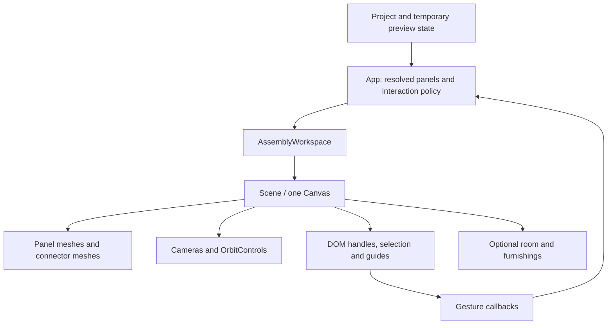

# Rendering and interaction

[Documentation index](README.md)

The editor combines a React DOM interface with one React Three Fiber viewport. Project geometry remains ordinary TypeScript data; the viewport receives resolved panels, connections, selection, and callbacks. It does not own the saved project. See [state and persistence](state-and-persistence.md) for commit and preview state, and [domain model and geometry](domain-model-and-geometry.md) for the construction rules behind the display.

## Component boundaries

| Area | Entry points | Responsibility |
| --- | --- | --- |
| Application composition | [`App.tsx`](../src/App.tsx) | Selects the active inspector, combines previews, decides which interactions are available, and routes callbacks to project operations. |
| Workspace chrome | [`AssemblyWorkspace.tsx`](../src/components/AssemblyWorkspace.tsx), [`ViewportControls.tsx`](../src/components/ViewportControls.tsx) | Studio/room mode, snapping controls, camera commands, pan mode, operation status, attachment notices, and optional furnishings. |
| Three.js scene | [`Scene.tsx`](../src/components/Scene.tsx) | Canvas, cameras, lights, panel meshes, connector meshes, selection highlights, dimensions, guides, and canvas gestures. |
| Inspectors | [`InspectorSidebar.tsx`](../src/components/InspectorSidebar.tsx), [`SinglePanelInspector.tsx`](../src/components/SinglePanelInspector.tsx), [`MultiPanelInspector.tsx`](../src/components/MultiPanelInspector.tsx), [`ConnectorInspector.tsx`](../src/components/ConnectorInspector.tsx), [`AssemblyInspector.tsx`](../src/components/AssemblyInspector.tsx) | DOM controls for editing the current selection. |
| Lists | [`PanelList.tsx`](../src/components/PanelList.tsx), [`ConnectorList.tsx`](../src/components/ConnectorList.tsx), [`GroupedList.tsx`](../src/components/GroupedList.tsx) | Selection, filtering, ordering, naming, visibility, and group interactions. |
| Dialogs and help | [`ProjectDialogs.tsx`](../src/components/ProjectDialogs.tsx), [`BuildGuide.tsx`](../src/components/BuildGuide.tsx), [`ExampleBrowser.tsx`](../src/components/ExampleBrowser.tsx) | Project flows, library browsing, parts/export dialogs, and the illustrated field guide. |

[`main.tsx`](../src/main.tsx) mounts the application under `React.StrictMode`. Global layout and theme rules live in [`index.css`](../src/index.css); feature styles are colocated under `src/components/`. Radix-backed dialog, tooltip, and button primitives live in [`components/ui/`](../src/components/ui/). Feature components also use native controls and disclosures. [`InspectorDisclosure`](../src/components/InspectorPrimitives.tsx) remembers expansion in an in-memory map and can defer mounting expensive content until first opened.

Panel and connector lists share filter defaults, active-filter counting, and matching helpers from [`list-filters.ts`](../src/lib/list-filters.ts). [`ListFilters.tsx`](../src/components/ListFilters.tsx) owns the non-modal native dialog shown through the Popover API and its filter controls; its runtime exports are React components so edits can use Fast Refresh. Opening the popover focuses Search; Escape and Close filters return focus to the trigger, while outside actions dismiss it without blocking the workspace.

## From project data to a frame

### Construction objects

The Objects tab routes source-volume selection separately from panels and connectors. [`use-construction-editor.ts`](../src/hooks/use-construction-editor.ts) owns selection, the session object clipboard, and source-bound numeric drafts. [`ConstructionObjectsList.tsx`](../src/components/ConstructionObjectsList.tsx) shows ordered nested operands, and [`ConstructionObjectInspector.tsx`](../src/components/ConstructionObjectInspector.tsx) provides box dimensions, center/rotation controls, group source-bound sizing, Boolean operation/order, and Apply/Cancel. Entering Objects clears furniture selection and cancels incompatible placement/constraint modes. Switching categories cancels an object draft. Text inputs and dialogs retain their shortcut guards; Escape inside the object form cancels the draft.

[`use-object-preview.ts`](../src/hooks/use-object-preview.ts) starts a dedicated [`object-preview.worker.ts`](../src/lib/object-preview.worker.ts) for the displayed source forest. Editing, switching to Realistic/exploded view, and unmount terminate the worker; source checks and cleanup guards discard obsolete results. Before starting another worker, `object-preview.ts` checks each previously evaluated root for unchanged Boolean topology, box dimensions/rotations, and a common translation of all leaves. Matching surfaces are reused immediately (with translated vertices when needed), keeping moving and stationary objects visible during movement. Complete reuse avoids worker startup; partial reuse keeps unaffected roots visible while changed shapes evaluate. Other prior results are never rendered against a newer source. Evaluation divides space at the boxes' exact axis-aligned boundary planes, evaluates ordered Boolean membership per rectangular region, and emits only boundary triangles. Independent roots remain separate. The total evaluation limit is 100,000 regions and 600,000 emitted vertices; exceeding it produces an explicit message instead of a coarse approximation or a blocked UI.

[`ConstructionObjectLayer.tsx`](../src/components/ConstructionObjectLayer.tsx) renders transparent blue surfaces and outlines, switching selected surfaces and leaf outlines to magenta while editing objects. Selected leaf outlines include hidden/cutting operands. Surface and outline materials disable depth writes; outlines remain visible through the volumes. Surface geometry is memoized by the evaluated positions and disposed on replacement/unmount; React Three Fiber owns the remaining declarative geometries and materials; there is no animation loop. Surfaces accept raycasts only while editing objects; switching into Objects explicitly restores the mesh raycast method because React Three Fiber skips undefined props. Click selects a visible source surface and Shift-click adds or removes it from the selection. Ordinary panels remain selectable through the passive blue layer. Both surfaces and operand outlines are absent in Realistic and exploded previews. Camera fitting includes visible source bounds and selected operands in Studio, including projects with no panels.

While editing Objects, amber surface highlights and focusable warning icons identify narrow sections of the evaluated solid. Hover or focus an icon for details. The early check flags continuous solid spans below 91 mm (40 mm minimum panel cut, 16 mm stock, and two measured 17.5 mm connector seats), including Boolean remnants; operand subdivisions alone do not trigger it. It is advisory: fitted-face exceptions may work, and wider sections can still fail hardware clearance. Convert to panels performs the full check for the chosen thickness. Warnings update with drafts and gestures, remain outside saved projects, and disappear outside Objects mode. The existing preview worker computes the narrow-cell mask in three linear sweeps; amber boundary triangles are reused and translated with their source surface, and discarded when geometry changes. Overlay geometry is disposed on replacement/unmount.

Canvas arrows move source selections along camera-projected world axes, grouping repeated keys into one history step. Grid settings supply the step size. X/Y/Z and inspector buttons rotate by 90° around the selected source bounds center; group numeric sizing scales world-axis dimensions while keeping each box orthogonal. [`use-object-gesture.ts`](../src/hooks/use-object-gesture.ts) snapshots the project, selection, and snapping settings for each Control-drag or resize. It keeps candidates outside history/autosave, retains the last valid candidate on rejection, and commits once on release with a source-identity guard. Escape, blur, and pointer cancellation discard candidates. The shared drag component raycasts `objectId` in object mode, including selected operand volumes; it retains panel routing by default. Resize handles scale source bounds along world axes with the opposite face fixed, including nested and rotated leaves. Focused handles accept arrow/plus/minus keys.

[`object-edit.ts`](../src/lib/object-edit.ts) supplies handles, edge scaling, and snapping to the world grid, unselected source-box boundaries under visible roots, and visible panel boundaries. Cutters contribute source boundaries; these are not Boolean surface features. Objects do not acquire physical attachments or enforce panel collision constraints. Keyboard snapping uses reduced tolerance to avoid trapping a selection. Object gestures currently have no alignment guide overlay.

B arms the shared box-selection component with object-only routing. It encloses visible evaluated root bounds; Shift adds roots and Escape cancels. Invisible operand pick meshes are excluded, so cutters remain selectable through the tree. Boolean surfaces are previews, not fabrication geometry.

[`ObjectConversionDialog.tsx`](../src/components/ObjectConversionDialog.tsx) reviews selected top-level objects with thickness/appearance inputs and a separate demand-rendered Scene showing the proposed furniture alongside existing parts. `object-conversion.worker.ts` evaluates the selected Boolean tree and solves supported cuboids, rectangular tunnels and blind recesses, and bounded orthogonal-prism results off the main thread. The dialog derives panel and physical hardware counts from the candidate and lists per-compartment clear dimensions and shared-wall counts for multiple roots or disconnected pieces of one root. Piece labels identify their source object; acceptance remains one transaction. Failed conversions retain a read-only source preview alongside existing furniture, with red boxes and a textual list naming affected source regions. `ConstructionObjectLayer` renders these non-interactive highlights with declaratively owned geometry; explicit diagnostic bounds frame evaluated results without letting oversized cutters dominate the view. Errors cannot be accepted. When a fitted construction uses convex outer end caps attached to one neighbor, the review reports their count from transient `singleSupportPanelIds`. The Rectangular panels only checkbox defaults off and restricts new panels; profile closing faces are partitioned into rectangles with wall attachments, or show an error when no supported layout fits. Input changes terminate the previous worker and immediately disable acceptance until the matching result arrives. Project replacement invalidates the dialog, and close/Escape/unmount terminates work. Acceptance performs a functional source-identity check before one `useProject` commit and selects the generated panels in Panels mode. Source objects remain saved but hidden; the furniture is independent.

`AssemblyWorkspace` removes panels and connections superseded by a preview before forwarding the base geometry. Ghost panels and connections are rendered separately, avoiding duplicate opaque originals under a replacement preview. Attachment candidates can also contribute to camera fitting without being drawn.

`Scene` creates a `Canvas` with shadows, `frameloop="demand"`, device pixel ratio limited to `[1, 2]`, antialiasing, and `preserveDrawingBuffer`. React changes, camera controls, and explicit `invalidate()` calls cause rendering. The realistic room's vacuum requests frames while moving; its initial dock wait uses a timer, and Studio and static previews retain demand rendering. Components using `useFrame` update screen projections when frames run. A WebGL fallback and `ViewportBoundary` show an error in the viewport if rendering cannot start, leaving the surrounding editor available.

`World` composes focused scene layers. `SceneParts` applies box-selection, constraint, and repetition highlights while keeping ordinary and ghost hardware separate. `SceneMovement` gates keyboard and drag movement using the active inspector category; `SceneResizeHandles` guards handle availability; `SceneOverlays` controls constraint, drag-snap, and attachment-side overlays. These components add no Three.js transform groups, so part coordinates and raycast identities remain unchanged.

[`SceneEnvironment.tsx`](../src/components/SceneEnvironment.tsx) owns Studio lighting, the ground grid and geometry guides, or the room environment. [`use-scene-snap-feedback.ts`](../src/hooks/use-scene-snap-feedback.ts) owns the 900 ms keyboard feedback timer and tracks accepted resize starts. It remains mounted across mode and handle visibility changes, ignores feedback from a different selection, and suppresses resize feedback for repetition. [`scene-snap-guides.ts`](../src/lib/scene-snap-guides.ts) resolves guide targets, sources, and direction in millimeters, giving the live pointer probe priority over keyboard feedback. The environment layer converts guide positions to meters when drawing.

Studio and Realistic preview share a fixed floor reference at world Y = 0, with a 12 mm rendering clearance for hardware. The Studio floor does not follow the lowest panel; elevated furniture stays visibly elevated in both modes. Move creation → Place on floor explicitly grounds the project.

Ground-grid meter marks are textured planes parallel to the floor, with depth testing enabled. They remain below ground panels instead of billboarding upward through them; their size follows camera zoom and they hide in edge-on views.

### Coordinate boundary

Project lengths and positions use millimeters, and rotations use Euler radians. A panel's geometry is centered on its local XY plane, with thickness centered along local Z. World Y is vertical.

The scene converts project millimeters to meters with `0.001`. Panel geometry performs that conversion when constructed; panel and connector positions are converted when assigned to Three.js groups. Drag ray intersections work in meters and convert deltas back to millimeters before calling editing code. Rotation values pass through unchanged.

Room layout and `FurnishingPlacement` values already use meters. CAD connector geometry also returns meter-based vertices. Converting these again would shrink them by another factor of 1,000. Camera bounds, lighting, and dimension-line geometry use scene meters; dimension labels convert back to millimeters.

### Cameras and navigation

The `CameraController` in `Scene.tsx` uses perspective projection for the perspective view and orthographic projection for front, top, and right views. Room mode forces a perspective camera and uses its own field of view and orbit limits.

Camera fitting projects the corners of the visible geometry's bounds into the current camera basis. Room fitting additionally includes scale-reference objects. `fitSignal` requests a normal fit; `frameSignal` can reframe while preserving the current viewing direction. Fitting clears pending control damping first so previous pan inertia does not move the result afterward.

`OrbitControls` handles ordinary camera gestures: left-drag orbits in perspective unless Pan view is enabled, right-drag pans, and the middle button dollies. In orthographic views, left-drag pans. The controls support touch gestures and screen-space panning. Zoom commands adjust perspective camera distance or orthographic zoom within their limits.

Exploded view is a display transform: panel positions are pushed away from the bounds center. It does not write positions into the project, and connector meshes and overall dimensions are omitted in this view.

## Panel geometry and materials

[`makePanelGeometry`](../src/components/scene-geometry.ts) builds a `THREE.Shape` and extrudes it through the panel thickness. Rectangles, rounded corners, and custom outlines share this path. Custom-outline coordinates are transformed from top-left panel coordinates into the centered scene plane. Pegboard circles and rounded slots are actual holes in the extruded shape, with clearance checks that keep each complete opening inside the contour.

The geometry builder has a performance guard: if the candidate perforation grid exceeds 5,000 openings, it skips creating the openings rather than changing their pitch. It uses eight curve segments and no extrusion bevel. Face UVs retain physical meter scale so grain does not stretch when the board dimensions change.

`PanelMesh` memoizes geometry by its shape inputs, textures by material/coverage needs, and materials by finish settings. Selected panels retain their finish at 80% opacity, with depth writes disabled so geometry behind them remains visible. This is transient scene feedback and does not change the saved finish. Its selection outline is a slightly expanded rectangular bounding box, even for a custom outline. The rendered custom contour therefore has more detail than this selection affordance.

[`wood-texture.ts`](../src/components/wood-texture.ts) generates deterministic wood texture data locally. Pixel sources are cached by material; each panel owns disposable texture wrappers referencing those sources. [`panel-materials.ts`](../src/components/panel-materials.ts) supplies separate face and edge materials. Finish coverage reduces grain color variation, bump, roughness variation, and birch plywood edge bands together. Painted material and full finish coverage avoid the wood maps. Ghost panels use translucent accent materials without grain or depth writes.

[`composite-texture.ts`](../src/components/composite-texture.ts) adds OSB wood flakes with individual grain and Nazena recycled-textile fibers over a mottled base. Deterministic fragments wrap across raster boundaries for seamless color, bump, and roughness maps. The same source cache and per-panel wrappers apply; 600 mm OSB tiles and 450 mm Nazena tiles keep fragment sizes fixed as panels resize. These materials texture the cut edges too, and finish coverage fades their detail with the faces. Maps are generated once on first use, without image requests or animation. They are visual approximations of the reference finishes.

Panel geometry, outline geometry, texture wrappers, and materials have explicit effect cleanup. Preserve this ownership when adding a panel visual: rebuilding a geometry on every selection change is unnecessary, while disposing a shared cache entry can break other meshes.

## TROFAST geometry

[`scene-geometry.ts`](../src/components/scene-geometry.ts) cuts rounded rectangular holes for saved TROFAST inserts. [`TrofastMeshes.tsx`](../src/components/TrofastMeshes.tsx) renders the matching hollow tapered plastic boxes, wire mesh boxes, and divided trays in both Studio and Realistic preview, with shadow-receiving materials and product-specific colors. The render uses fixed real outer sizes from the catalogue; molded profiles, colors and cutout sizes are visual approximations.

[`trofast-geometry.ts`](../src/components/trofast-geometry.ts) caches immutable geometry for application lifetime. Instance materials use declarative React Three Fiber ownership; cached geometry is attached as a primitive and is not disposed per instance. There is no animation loop or network model dependency. Box mesh selection, context menus and box selection refer to the host panel. Camera fitting includes insert bounds. Auto furnish excludes panels with openings and treats hanging boxes as obstacles for other surfaces.

## Connector geometry and materials

[`ConnectorMeshes.tsx`](../src/components/ConnectorMeshes.tsx) gets each connection's allowed rail and clamp placements from [`connector-movement.ts`](../src/lib/connector-movement.ts). It derives physical connector IDs from the connection ID and clamp index, applies per-piece finish/removal/slide overrides, and renders each remaining piece. Connector selection is attached to the enclosing group so all CAD bodies belonging to one clamp identify the same part.

[`components/connector-geometry.ts`](../src/components/connector-geometry.ts) is a compatibility re-export; the implementation is [`lib/connector-geometry.ts`](../src/lib/connector-geometry.ts). The latter imports the checked-in OBJ with Vite's `?raw` suffix, parses it once, selects the bodies for each connector type, recenters and rotates them to a common joint coordinate system, and converts their source millimeters to scene meters. No model download occurs at runtime.

These CAD geometries are application-lifetime shared objects. Callers must not mutate or dispose them. The meshes use `dispose={null}` to protect this ownership, while each connector piece explicitly disposes its own material. Loader-default OBJ materials are disposed after parsing because the application provides the finishes.

Metal 90° connectors reuse the CAD profile through [`connector-metal.ts`](../src/components/connector-metal.ts), adding UVs and local procedural texture/reflection resources. The reflection environment is generated with Three.js's room environment and PMREM, without an external HDR image. `ConnectorMeshes` creates these GPU resources in a layout effect, shares them among metal pieces in that mesh layer, and disposes them when the layer no longer needs them. Creating them during render or keeping a disposed render target across Strict Mode effect replay would violate this lifecycle.

## Interaction and focus ownership

Interactions are split between DOM gesture handling and domain operations. Gesture components translate pointer or key input into a selection, direction, or distance. The hooks and model helpers decide whether a move or resize preserves the construction and whether to commit it.

### Selection and keyboard input

Panel meshes put `panelId` in `userData`; connector groups put `connectorId` there. These identifiers support click handling, raycasting for context menus and drag starts, and box selection. Ghosts do not expose selectable IDs. Normal clicks select a part, with Shift/Command/Control allowing additive selection. Clicking empty canvas clears selection through the application callback. Assembly-aware expansion and drill-in decisions remain in `App` and the assembly hook.

`PanelKeyboardMovement` registers Studio arrow-key handling on the canvas itself. Pointer interaction focuses the canvas, which has a tab index and accessible label. The handler reads the live camera on every keypress, including during orbit damping, and delegates panel directions to [`panel-movement-direction.ts`](../src/lib/panel-movement-direction.ts). The default movement is 10 mm, or 100 mm with Shift. With grid snapping enabled it uses one grid interval, or ten with Shift. Connector arrows instead compute allowed slides along their rails. Gesture tracking groups repeated movement presses for undo and resets on keyup or blur. Realistic preview reserves plain arrow keys for the vacuum, so those inputs do not nudge the selected panels.

Global shortcuts live in `App.tsx`. They ignore prevented/composing events, text inputs, selects, textareas, contenteditable elements, and dialogs. X/Y/Z rotate the selection; Shift+X/Y/Z mirror it across its center on the corresponding world axis. Both use the same active-operation and selection guards, ignore key repeats, and commit one undo step per press. The active Panels/Connectors tab determines which type receives movement when a mixed selection exists; both types remain highlighted. New shortcuts must respect these distinctions so typing or editing a list does not transform the model.

### Control-drag movement

[`PreviewDragMovement.tsx`](../src/components/PreviewDragMovement.tsx) captures Control + left-pointer gestures before `OrbitControls` sees them. It raycasts a panel, defines a camera-facing drag plane at the hit, captures the pointer, and temporarily disables camera controls. Crossing a four-pixel threshold starts movement only if the hit panel is already selected. A stationary Control-click retains additive selection behavior.

Pointer deltas are measured against the initial intersection, converted to millimeters, and passed to [`use-preview-drag.ts`](../src/hooks/use-preview-drag.ts). The domain preparation releases joints crossing the selection boundary in a temporary project, then translates the selected construction with ordinary snapping and optional new attachment candidates. Movement also releases incidental contacts across that boundary; internal joints and user rules are retained. Release completes the operation; Escape, pointer cancellation, or window blur cancels it and preserves the original construction. During a pending drag, shortcuts and wheel input are intercepted so the project and camera cannot change underneath the gesture. Cleanup restores controls, pointer capture, and the cursor.

### Resize handles

[`PreviewResizeHandles.tsx`](../src/components/PreviewResizeHandles.tsx) projects structural handles into screen-sized DOM buttons. A stable Drei `Html` portal keeps the overlay attached to the canvas container. Projection hides handles pointing almost directly toward the camera and separates overlapping arrows so each remains reachable. Layout changes update the DOM hit targets immediately, including after cancellation; demand-rendered frames keep them aligned during camera movement.

A resize handle retained for compartment repetition can still accept Shift-drag on a panel edge. The connected-resize availability probe does not determine independent-edge feasibility; the local resize solver checks that gesture against fixed hardware and the existing limits. Plain drags on these handles explain the Shift and Control alternatives.

A pointer drag uses a camera-facing plane containing the handle's structural axis. Projecting its movement onto that axis produces a distance in millimeters for [`use-preview-resize.ts`](../src/hooks/use-preview-resize.ts). Shift held at pointer-down requests independent panel-edge resizing; Control requests repetition of a rectangular compartment through [`structure-repeat.ts`](../src/lib/structure-repeat.ts). Repetition supports the cell's width, height, and depth axes, using panel edge handles or outward panel-normal handles. The mode stays fixed throughout the drag. Repetition highlights the source cell, displays the bay count and snapped distance, and stops at the last valid count. Newly added panels and changed hardware appear as ghosts; reused destination panels retain their existing appearance with a selection outline. The caption says Repeat · N bays and separately reports the number of reused panels, since the traversed bays need not all be new. Arrow keys and plus/minus on a focused handle perform a complete resize operation at the configured keyboard step, with Shift multiplying that step by ten. Control + ArrowUp, ArrowRight, or plus instead adds one whole bay along that panel handle. After repetition advances the selection, arrow focus follows the previous world direction, including when a reused panel represents that direction with exchanged local width/height axes. Control-drag on panel geometry retains its separate movement behavior.

The hook provides the valid result, actual distance, and limit status; the component displays them and owns pointer/camera cleanup. `App` and `Scene` disable conflicting movement, attachment, box-selection, and resize interactions. Handle availability also depends on the domain-level resize options.

### Box selection and context menus

[`PreviewBoxSelection.tsx`](../src/components/PreviewBoxSelection.tsx) owns capture-phase pointer input while box selection is armed. It disables orbit, draws a DOM rectangle, previews candidate highlights, and forwards the final panel and connector IDs together. Shift adds to existing selection. Escape, blur, Tab, or interaction outside the canvas cancels the mode appropriately.

[`box-selection.ts`](../src/lib/box-selection.ts) projects visible mesh bounding-box corners into normalized device coordinates, aggregates them by part ID, and requires the entire projected part to be inside the rectangle. It selects through occluding objects, skips invisible geometry, and rejects clipped or behind-camera bounds. It is a bounds-based selection algorithm, not pixel or silhouette coverage. Application callbacks expand linked assemblies as whole instances, or restrict candidates to the assembly currently being edited.

`PreviewContextGesture` in `Scene.tsx` opens a menu only after a stationary right-click, preserving right-drag pan. It raycasts the same part IDs and supports the Context Menu key and Shift+F10. [`PreviewContextMenu.tsx`](../src/components/PreviewContextMenu.tsx) renders the DOM menu; `App` supplies actions for the current target and selection through `preview-menu-actions.ts`. Preview actions appear in ordered Selection, Build, Assembly, Organize, Remove, and Preview groups, omitting empty groups. Group labels and separators are not keyboard stops; arrow keys and Home/End move through all commands, including disabled items, and Escape restores focus. List menus reuse the component without section labels.

### Attachment affordances and snapping

Assembly attachment buttons belong to the application's DOM root. `AttachmentHandlePositions` projects their millimeter positions through the camera on rendered frames, hides offscreen choices, and separates overlapping buttons. Hover and keyboard focus preview an attachment; clicking commits it. [`AttachmentSideGuide.tsx`](../src/components/AttachmentSideGuide.tsx) renders the panel-relative A–F side labels and links their hover/selection state to the inspector. These affordances disappear during conflicting modes.

[`preview-snap.ts`](../src/lib/preview-snap.ts) defines independent global-grid and geometry-alignment settings. Both default to off; default spacing is 50 mm and tolerance is 10 mm. Grid alignment is anchored at the world origin. Panel targets are world-axis bounds, including bounding extents for rotated panels, while connector targets are physical clamp centers. `snapDistance` preserves a constrained direction rather than moving a handle off its rail.

Snapping preferences and guide visibility are separate. `Show grid` determines whether the ground grid and geometry guides are drawn; hiding them does not disable snapping. Domain constraints still decide whether a requested snapped move is possible. Geometric alignment is also distinct from drag-to-attach, which creates physical connections through the drag hook's placement logic.

### Design-rule authoring and measurements

[`DesignConstraintsInspector.tsx`](../src/components/DesignConstraintsInspector.tsx) reuses the inspector disclosure and existing number/select fields. Disclosure badges are derived from the current model and remain visible when collapsed: custom panel shapes/surfaces, fitted inserts, saved constraints in the current scope (including disabled rules), and instance appearance overrides. Badge descriptions are accessible without changing section control names; drafts do not add badges before acceptance. Its Constraints section shows selection-specific or all-project rules, with active/disabled/attention states and edit, find, enable, and remove actions. Context-menu Add constraint and All constraints, and the workspace Constraints control, open the same inspector. Clearing the selection hides this section. Explicitly opening All constraints without a selection shows a project-wide manager in place of the empty-inspector prompt; Done or Escape returns to the empty inspector, and selecting a panel or connector exits that view. The form distinguishes cut dimensions from world elevation and labels ordered gap panels as lower/upper, left/right, or back/front. Numeric rules offer Exactly, At least, At most, or Between. Between shows separate minimum and maximum fields; an inverted range remains an editable draft with Apply disabled. Targets are entered in millimeters, and descriptions and scene labels identify the permitted limit or interval alongside the actual measurement.

[`use-design-constraints.ts`](../src/hooks/use-design-constraints.ts) supplies a source-bound candidate project while the form is open. `App` displays that candidate's resolved panels and connections without committing it, reports the affected panels, and sends the active rule to [`DesignConstraintOverlay.tsx`](../src/components/DesignConstraintOverlay.tsx). The overlay draws dimension/reference lines in the existing demand-rendered scene with noninteractive HTML measurement labels; it adds no animation loop. Hover/focus on an existing rule highlights its referenced panels and measurement. Unsupported measurements do not draw misleading lines. Floor-rule previews include Y = 0 when framing the measurement; the Studio grid stays at the world floor while a floor rule is active. Valid draft changes frame the measurement while preserving the viewing direction.

Opening a rule draft suppresses conflicting canvas movement, resize, box-selection, attachment handles, and editing shortcuts. Pick in preview routes the next eligible panel click to the draft without changing the workspace selection; narrow drawers close temporarily while picking. Escape exits picking first, or cancels the form and restores focus; pointer-independent selectors and the same Add/Save controls support keyboard use. The form's status and Add constraint / Save constraint / Cancel actions use the inspector footer, keeping them reachable while the form content scrolls in desktop and narrow layouts. Rule preview state, active highlights, and the temporary reference-panel preference are not persisted.

## Realistic preview

Room mode reuses the existing panel and connector mesh implementations in the same viewport. [`RoomEnvironment.tsx`](../src/components/RoomEnvironment.tsx) supplies a procedural room, reference furnishings, lighting, and shadows. [`room-layout.ts`](../src/components/room-layout.ts) sizes the room from the design's extents but anchors its placement to the world origin, so translating a creation does not translate the room. Reference objects retain their physical scale. Procedural room textures and locally created geometry have effect cleanup.

Room mode suppresses Studio attachment ghosts, attachment buttons, the side guide, grid, and exploded presentation. It does not make the entire workspace read-only: eligible Control-drag movement, resizing, rotation, and undo remain connected. Direct connector click selection and connector context-menu targeting are suppressed in `Scene` while the existing selection can still be represented.

The room includes a procedural black Dreame X50 Ultra Complete vacuum and dock, modeled in meters by [`RobotVacuumModel.tsx`](../src/components/RobotVacuumModel.tsx), using [Dreame's published product dimensions](https://global.dreametech.com/products/dreame-x50-ultra-complete). [`RobotVacuum.tsx`](../src/components/RobotVacuum.tsx) waits for about ten seconds of visible room time before leaving the dock; [`robot-vacuum-motion.ts`](../src/components/robot-vacuum-motion.ts) advances the robot slowly along its route and turns it at corners. Its runtime position and timing remain outside project state; editing project geometry or reentering room mode resets it at the dock. Toggling Auto furnish preserves the robot's position, heading, and elapsed wait while updating obstacle clearance and rejoining a safe route from its current position. Hidden tabs pause both the wait and motion, and cleanup stops scheduled work when room mode ends. The model uses local geometry and materials, with no external asset requests.

[`use-vacuum-control.ts`](../src/hooks/use-vacuum-control.ts) owns departure and idle timers, visibility, and keyboard input. Plain arrow keys take manual control of the room vacuum: Up/Down drive along its heading and Left/Right turn. Held keys continue movement; releasing the last key leaves it still for ten seconds of visible idle time, then automatic cleaning rejoins a safe route from the current pose. New driving input restarts that idle period. Fields, dialogs, menus, resize-handle buttons, and modified shortcuts retain their own input. Blur and hidden tabs release held keys, and hidden time does not consume the idle period. Manual motion uses the same obstacle clearance and never commits a project edit.

[`robot-vacuum-recovery.ts`](../src/components/robot-vacuum-recovery.ts) keeps only the bends needed to retrace a manual drive. If driving reaches a pocket omitted by the automatic grid, the vacuum follows this trail back to the cleaning route once, checking every segment against the current obstacles. Taking control again during that return retains the way out. The trail is discarded after reaching the normal sweep; a new furnishing that blocks the return makes the vacuum wait instead of passing through it. Keyboard capture is scoped to the workspace and excludes list navigation and other input owners.

[`robot-vacuum-navigation.ts`](../src/components/robot-vacuum-navigation.ts) chooses a clear dock placement and builds a deterministic route through connected floor space on a grid capped at 128 × 128 cells. Clearance includes the room boundaries, reference furniture, resolved visible project panels, hanging TROFAST items, and optional preview furnishings. Raised surfaces allow passage when there is enough vertical clearance. If no clear dock and exit fit, the vacuum scenery is omitted. Conservative bounds and grid spacing can exclude physically reachable narrow pockets, including around rotated panels, custom outlines, and perforations; the animation does not simulate the product's sensors.

Auto furnish is optional local workspace state. `AssemblyWorkspace` calls [`detectPreviewFurnishings`](../src/lib/preview-furnishings.ts) only when both room mode and Auto furnish are active. Detection is deterministic, uses oriented bounding boxes for clearance, and considers visible solid horizontal panels. It excludes custom outlines, perforated panels, and tilted surfaces. Candidate work is capped at 96 surfaces, output at 32 furnishings, and people at two.

[`PreviewFurnishings.tsx`](../src/components/PreviewFurnishings.tsx) renders these meter-based placements as procedural books, accessories, decor, people, and chairs. [`preview-books.ts`](../src/lib/preview-books.ts) supplies deterministic book arrangements and bounds shared with clearance detection. Furnishings remain preview data: they are not project panels, connectors, exported parts, or undoable edits.

## Workers, library previews, and help

Two expensive split checks run in module workers created with `new Worker(new URL(..., import.meta.url), { type: 'module' })`, allowing Vite to bundle them:

| Caller | Worker | Result handling |
| --- | --- | --- |
| [`useParallelPanelSplitCounts`](../src/hooks/useParallelPanelSplitCounts.ts) | [`parallel-panel-split.worker.ts`](../src/lib/parallel-panel-split.worker.ts) | Streams supported divider counts, then marks checking complete. Results are associated with the original project and selection identities. |
| [`GridPanelSplit`](../src/components/GridPanelSplit.tsx) | [`grid-split.worker.ts`](../src/lib/grid-split.worker.ts) | Debounces changes by 120 ms, computes a complete proposed split or error, and enables Apply only for a matching successful result. |

Both callers terminate workers during effect cleanup. The workers run existing domain functions and return ordinary structured-clone data; they do not own project state. Project, selection, and input identity checks prevent older results from being displayed as current.

Library thumbnails in `ExampleBrowser` are memoized SVG projections of the same example factories that create editable projects. They use simplified panel box faces and connector markers, avoiding a separate WebGL context for every card. They are previews of the construction rather than fabrication renderings of every custom detail.

`ProjectDialogs` lazy-loads `BuildGuide` under `Suspense`. Guide content and scenes live in [`build-guides.ts`](../src/lib/build-guides.ts), [`build-guides-workflows.ts`](../src/lib/build-guides-workflows.ts), and [`guide-scenes.ts`](../src/lib/guide-scenes.ts). [`GuidePreview.tsx`](../src/components/GuidePreview.tsx) projects the current lesson's panel outlines and cached CAD connector silhouettes into SVG. The dedicated Boolean and object-solver lessons in [`build-guides-objects.ts`](../src/lib/build-guides-objects.ts) use [`guide-object-scenes.ts`](../src/lib/guide-object-scenes.ts) to evaluate small source trees and generate real conversion results. Source-only studies project the evaluator’s boundary faces into SVG in the same stable frame as the panel studies; these cached teaching fixtures do not invoke the interactive worker lifecycle. It adds no WebGL canvas or continuous rendering loop and does not edit the open project. Reading position is session state.

## Where to verify changes

Use the nearest geometry tests for deterministic calculations and browser tests for focus, pointer ownership, camera behavior, and the visible workflow:

| Concern | Existing coverage |
| --- | --- |
| Panel holes, outlines, rounding, and materials | [`scene-geometry.test.ts`](../src/components/scene-geometry.test.ts), [`wood-texture.test.ts`](../src/components/wood-texture.test.ts), [`custom-outlines.spec.ts`](../tests/custom-outlines.spec.ts), [`rounded-panels.spec.ts`](../tests/rounded-panels.spec.ts), [`finish-coverage.spec.ts`](../tests/finish-coverage.spec.ts) |
| CAD parts and connector appearance | [`connector-geometry.test.ts`](../src/components/connector-geometry.test.ts), [`connectors.spec.ts`](../tests/connectors.spec.ts), [`connector-material.spec.ts`](../tests/connector-material.spec.ts) |
| Canvas movement and navigation | [`panel-movement-direction.test.ts`](../src/lib/panel-movement-direction.test.ts), [`panel-movement.spec.ts`](../tests/panel-movement.spec.ts), [`preview-drag.spec.ts`](../tests/preview-drag.spec.ts), [`preview-pan.spec.ts`](../tests/preview-pan.spec.ts) |
| Resize, repetition, and snapping | [`preview-resize.test.ts`](../src/lib/preview-resize.test.ts), [`structure-repeat.test.ts`](../src/lib/structure-repeat.test.ts), [`preview-snap.test.ts`](../src/lib/preview-snap.test.ts), [`scene-snap-guides.test.ts`](../src/lib/scene-snap-guides.test.ts), [`preview-resize.spec.ts`](../tests/preview-resize.spec.ts), [`preview-repeat.spec.ts`](../tests/preview-repeat.spec.ts), [`preview-snap.spec.ts`](../tests/preview-snap.spec.ts) |
| User rules and measurement previews | [`design-constraints.test.ts`](../src/lib/design-constraints.test.ts), [`design-constraints.spec.ts`](../tests/design-constraints.spec.ts) |
| Selection and overlays | [`box-selection.test.ts`](../src/lib/box-selection.test.ts), [`box-selection.spec.ts`](../tests/box-selection.spec.ts), [`preview-context-menu.spec.ts`](../tests/preview-context-menu.spec.ts), [`attachment-sides.spec.ts`](../tests/attachment-sides.spec.ts) |
| Room, furnishings, help, and layout | [`room-layout.test.ts`](../src/components/room-layout.test.ts), [`robot-vacuum-navigation.test.ts`](../src/components/robot-vacuum-navigation.test.ts), [`robot-vacuum-motion.test.ts`](../src/components/robot-vacuum-motion.test.ts), [`preview-furnishings.test.ts`](../src/lib/preview-furnishings.test.ts), [`robot-vacuum.spec.ts`](../tests/robot-vacuum.spec.ts), [`realistic-preview.spec.ts`](../tests/realistic-preview.spec.ts), [`build-guide.spec.ts`](../tests/build-guide.spec.ts), [`sidebar-layout.spec.ts`](../tests/sidebar-layout.spec.ts) |

The practical constraints for rendering changes are to preserve the millimeter/meter boundary, demand-driven rendering, gesture cleanup, keyboard focus rules, and ownership of shared versus per-mesh resources. A visual change can also affect geometry tests, box-selection bounds, preview fitting, and SVG illustrations; inspect those consumers when changing a shared shape or connector helper.

### Nice values and live feedback

`RescaleCreation` configures saved millimeter steps. Length fields keep uncommitted text while typing and apply rounding on Enter/blur. Preview resize and free-drag hooks round only during their end handlers; pointer movement continues through the existing continuous preview and optional snap paths. Release re-solves against the gesture source and preserves stale-source/cancel guards. Exact attachment candidates bypass coordinate rounding. Keyboard movement and resize handles use the nice-value step before the grid/default increment; Shift still multiplies it by ten. Connector keyboard movement uses that increment while retaining exact rail limits. The workspace grid settings remain independent of this input policy.

The **A** shortcut opens the existing new-panel attachment preview for exactly one ordinary selected panel, as does **Attach a panel (A)** in the preview context menu. It respects text/dialog focus and is disabled during box selection, gestures, clipboard placement, constraint editing, assembly editing/placement, and an active attachment preview. Opening it leaves realistic/exploded view for Studio and does not commit a panel until the attachment is accepted.

Attachment side buttons in the inspector and the A–F preview labels share `AttachmentSideGuideState.onSelect`. Activating the already selected side toggles the draft’s `flip`; selecting another side preserves it. Native button Enter/Space activation follows the same rule. Hover and focus only highlight sides. These changes remain in the attachment draft until Apply; Cancel leaves the project untouched.
