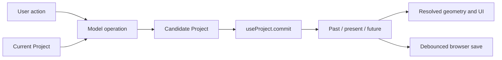

# State, editing transactions, and persistence

[Documentation index](README.md)

The editor keeps a serializable `Project` in React state and passes immutable replacements through one history hook. Selection, camera controls, dialogs, drafts, and geometric previews live outside that project. This boundary is what makes an accepted edit undoable and autosaved while a canceled preview leaves the saved construction unchanged.

The main entry points are [App.tsx](../src/App.tsx), [use-project.ts](../src/hooks/use-project.ts), and the [project types](../src/lib/types.ts). Geometry and assembly relationships are described in [Domain model and geometry](domain-model-and-geometry.md).

## State ownership

| Owner | State and responsibilities | Saved with a project? |
| --- | --- | --- |
| `useProject` | Current project, past/future snapshots, repeat-group token, save status, startup repair notice | Current project only |
| `useDirectorySync` | Folder access, file listing, active filename and expected disk content, dirty state, disk autosave, and pending open confirmation | No; only the directory handle is remembered separately in IndexedDB |
| `App` through `useEditorState` | Panel and connector selections, inspector/list tabs, dialogs, new-panel draft, attachment options, camera-view choice, sidebar visibility, exploded/realistic preview switches, context menu, notifications | No |
| `useAssemblyEditor` | Which instance is being edited, assembly placement mode, hovered placement target | No |
| `useCopyPaste` | In-memory copied panels/connectors/assembly, insertion candidates, hovered candidate | No |
| `usePreviewDrag` / `usePreviewResize` | Gesture source, latest candidate project, transient displayed geometry | No |
| `useDesignConstraints` / `DesignConstraintsInspector` | Rule form draft, reference-panel preference, source-bound candidate, measurement highlight, and feedback | Only the accepted rule and geometry |
| `useAttachmentPreview` | Derived candidate project, preview panels/hardware, validation issues | No |
| Local form components | Unapplied outline, parameter, color, and field drafts | No |
| `Project.niceValues` | Optional enabled flag and millimeter step for committed length inputs | Yes |
| `App` snap settings | Grid/geometry snapping flags, spacing, tolerance | Separate browser preference |

The `Project` includes user-visible organization as well as geometry: names, panel visibility/order, connector order, list groups, custom palette colors, and per-piece connector overrides. Those edits go through history just like resizing a panel. Flat list groups are independent of physical assembly membership.

Panel `material` accepts `birch`, `oak`, `walnut`, `mdf`, `osb`, `nazena`, and `painted`. OSB and Nazena use the existing version 1 material field in project panels, assembly definitions, and instance finish overrides. They add no saved texture data or required fields; existing files retain their material/color defaults. Copies, standalone assemblies, and cutting lists preserve the material IDs.

Polygonal hole fillers store their normalized `Panel.customOutline` and optional `Connection.outlineEdge` references in the version 1 format. An index refers to the child outline segment from that vertex to the next; the connection's ordinary parent and child IDs supply the surrounding-panel relationship. Parsing validates the index and restricts it to supplemental 90° joints or complete T joints with two outline children and a rectangular rim as the stem. Both T branches must carry valid edge indices. Older connections omit the field and retain rectangular behavior. Closing and subsequent frame reshaping commit complete geometry and connections together, so undo, redo, autosave, and project export retain the fitted shape. Assembly and copy operations remap the normal panel IDs while retaining local edge indices; a detached standalone panel retains its cut outline without the removed supports. Automatic hardware clearance saves new slide positions in the existing `connectorOverrides` map in the same undo step; it does not change the file version or relocate retained original hardware. These positions survive full-project export/reload. Standalone assembly files and new instance creation retain their existing exclusion of project-level per-piece overrides.

Uneven-depth closure proposals carry transient rim-extension descriptions on `PanelHole.alignment`; they are not saved project fields. Selecting a proposal or opening it from the context menu leaves history untouched. **Align edges & close hole** recalculates the constrained fit, then commits all extensions, carried outline fillers, and the new panel in one snapshot. Undo therefore restores the original rim depths and removes the closing panel together. Split-sided rectangles use the same saved outline-edge format as other polygonal fillers.

`App` and its [selection hooks](../src/editor/use-editor-selection.ts) derive resolved panel transforms with `resolvePanels(project)`, physical hardware with `orderedConnectors(project)`, and warnings/errors with `validateProject(project)`. These are derived views of the project rather than additional persisted stores. There is no Redux/Zustand store or server synchronization layer.

The editor composition components receive state and callbacks; changing inspector branches does not relocate application state into those branches. Local form drafts retain their existing keys and lifetimes. [use-displayed-panels.ts](../src/editor/use-displayed-panels.ts) chooses constraint and TROFAST preview geometry without committing it. Selection pruning and notification effects remain separate from history and never add an undo entry.

`useEditorState` clears a pending connector-fit review when its source project changes, before rendering children, matching the resize and movement reviews. Palette changes also reconcile the attachment draft color before rendering: retain a color still in the palette, otherwise follow its stable palette ID to the replacement color or use the first palette color. These adjustments remain outside project history.

## A committed edit



`commit` accepts either a complete `Project` or a function from the current project to the next project. Functional updates are especially important for commands that may arrive faster than React renders, such as held movement keys.

In [use-project.ts](../src/hooks/use-project.ts):

1. A `latest` ref holds the newest history synchronously. `changeHistory` evaluates an operation against that ref and updates it before scheduling the React state update. A second command therefore does not solve geometry against a stale render.
2. `ensureProjectPalette` adopts missing panel finish colors into the custom palette.
3. An ordinary JSON-equal edit is a no-op: it creates neither a history entry nor a new present value. Explicit `{ replace: true }` starts a new document identity even if the file contents match, so identical files cannot inherit each other's disk binding.
4. An ordinary commit appends the previous project and its transient document identity to `past`, keeping at most 60 past snapshots, and clears `future`.
5. `{ group, repeat }` can fold successive commits into one undo step when `repeat` is true and the group matches. Panel and connector keyboard movement use separate group names. The first non-repeat event starts a new step.

History stores complete project snapshots, not commands or geometry diffs. Mutating an earlier project object in place would corrupt both undo and preview comparisons; model operations must preserve prior snapshots. Normal `commit` calls use `assertDesignConstraintEdit` as a final guard on user rules. They also use [`assertOutlineConnectionEdit`](../src/lib/outline-connection-edits.ts) to prevent direct outline, placement, thickness, or hardware edits from invalidating fitted polygon supports. Resetting an attached filler to a rectangle is rejected with guidance to resize the frame or detach the filler; the saved shape and history remain unchanged. These guards are not universal geometry validation: domain operations still enforce joints, stock limits, collisions, and insert fit. Exceptions propagate synchronously to the caller, where UI flows generally show a message without replacing the project.

The rule guard preserves existing constraints when a reconstructed candidate omits the property. Explicit rule removal uses an empty array. Starting a new project, replacing a template, and importing use `{ replace: true }`, which bypasses comparison with the old document's rules while preserving ordinary history. Undo and redo restore complete snapshots and their document identities directly. `getSnapshot()` reads the latest committed project and identity synchronously for asynchronous file operations; this metadata is never serialized into project files or browser recovery saves.

Undo moves the current project to the front of `future` and restores the last past snapshot. Redo reverses that movement. Both reset the repeat-group token and trigger autosave of the restored project. Selection and camera state are not part of these snapshots; effects remove selections whose IDs no longer exist.

Starting a blank project, applying a template, and importing a project also use `commit`. They replace the current construction without clearing the in-memory undo stack. That allows Undo to restore the previous project until the page is reloaded. New-project and template replacement confirmation UI is coordinated through `App` and [ProjectDialogs.tsx](../src/components/ProjectDialogs.tsx).

## Preview and draft transactions

### Panel overlap repair

`useEditorState.overlapRepair` holds the source snapshot and clicked panel ID outside history. `PanelOverlapDialog` uses `panel-overlap-repair.ts` to search a bounded set of joint-preserving moves and local edge trims. Each accepted search step removes an overlap without introducing new validation diagnostics. The review lists all resolved panel changes; failure offers no partial candidate. Apply uses a functional source-identity guard and one history entry. Project changes invalidate the review, modal guards block background edits, and Cancel/Escape returns focus without changing the project. The existing conservative panel overlap checks still apply to shaped panels; this is not fabrication validation.

### Equal panel sizes

`useEditorState.equalSizes` holds a source snapshot and selection outside history. `EqualPanelSizesDialog` offers existing values and a custom numeric input for the sole differing width, height, or thickness and lists selected sizes plus all resolved candidate changes. `equalizePanelSizes` uses the simultaneous constrained dimension solver and insert checks; linked assembly members are excluded. Apply checks source identity inside a functional commit, producing one history entry. Modal guards block background gestures, project changes invalidate the dialog, and Cancel/Escape discards the draft. No saved fields or persistent equality rules are added.

### Reviewed resize alternatives

Failed numeric Width/Height edits on ordinary panels can open `ResizeAlternativesDialog` through `createPanelEditCommands`. `useEditorState.resizeReview` holds the source project and fully validated candidate alternatives outside project history. Radio choices only change the displayed review table. Cancel/Escape restores focus and leaves the committed project unchanged; Apply uses a functional source-identity check and commits one candidate as one undoable edit. Project changes invalidate the review, and modal guards prevent keyboard and canvas commands from editing behind it. Compound property patches, gesture resizing, and shared assembly editing do not enter this review workflow.

### Reviewed movement stages

`MovementReviewRequired` interrupts a scoped movement before any history update when only wider candidates are feasible. `useEditorState.movementReview` retains the source snapshot and candidate alternatives. `MovementAlternativesDialog` shares the panel-change table with resize review, adds outside-size consequences, and returns focus on close. Cancel/Escape changes nothing. Apply uses `acceptMovementAlternative` inside a functional commit, checks source identity, and creates one separate undo step; ordinary accepted movement keeps existing repeated-key grouping. Project changes discard stale reviews, and the modal blocks further keyboard/viewport movement. Candidate descriptions, scopes, and approval state are transient and never serialized.

### Auto-connect fitting

Auto-connect size proposals remain source-bound in `App.pendingConnectionFit`. Coordinated angled fits include a list of both panel dimension changes for `PanelConnectionFitDialog`; no project data changes while reviewing. Cancel/Escape discards the candidate. Acceptance checks source identity and commits all prior exact/snapped fits, coordinated resizing, and new hardware together as one history entry.

### Panel attachment

[use-attachment-preview.ts](../src/hooks/use-attachment-preview.ts) derives a complete candidate using `attachPanel` or `attachExistingPanel`, resolves its transforms, and identifies changed or newly added panels. It also selects connections needed to render the ghost and validates issues involving preview panels. The Apply action is enabled only when a candidate exists and its attachment errors are empty. Applying commits the candidate once; changing side, count, angle, or draft dimensions only recalculates the preview.

Opening an attachment form initializes its connector color from the project's most-used installed color, including per-piece overrides. Explicit color changes stay in that draft until acceptance or cancellation. A later attachment recalculates the default from the current project, including after import or undo. Automatic construction commands make the same choice from their source snapshot and save the resulting ordinary connection colors with the accepted edit; no new preference or project field is stored.

### Dragging and resize handles

[use-preview-drag.ts](../src/hooks/use-preview-drag.ts) prepares a drag session from the source project. Pointer movement computes candidates with the geometry/snap helpers in [preview-drag.ts](../src/lib/preview-drag.ts) and [preview-snap.ts](../src/lib/preview-snap.ts). React state makes the candidate visible, while a ref retains the latest result for pointer release. The hook only displays or commits a candidate while its original project is still the current project. A canceled gesture discards its candidate; an accepted gesture commits once. Dragging can also finish with a supported attachment candidate.

Control-drag preparation releases joints crossing the selection boundary in the candidate while preserving the construction's world poses and internal joints. Movement also releases incidental contacts across that boundary while preserving user rules. It then translates the selection and can fit new attachment hardware. This differs from keyboard movement and connected resize, which solve changes while preserving the existing joints. Canceling a drag restores the original connections because the released construction was never committed.

[use-preview-resize.ts](../src/hooks/use-preview-resize.ts) follows the same pattern with a prepared resize source, selected handle, and connected, independent-panel, or repeat mode chosen at gesture start. It verifies that the gesture still refers to the current prepared source. Resize distances pass through snapping and [preview-resize.ts](../src/lib/preview-resize.ts), which can return a size-limited result. Control-pull instead uses [structure-repeat.ts](../src/lib/structure-repeat.ts), snapping to whole compartment counts along the chosen width, height, or depth axis and caching candidate projects within that session. Candidate construction reuses exact matching destination panels under their existing identities and adds only missing parts. Pulling back removes only preview additions, including the divider boards and hardware of depth repeats; it never deletes reused destination panels. Source highlighting, repeat count, and cached candidates remain transient; saved results use the existing panels/connections format. Release commits a changed valid result once; after repetition, selection advances to the corresponding panel in the last traversed bay. A fully existing candidate with no geometry or rule changes advances selection without creating a history entry. Continuing from the newest depth bay recognizes its trailing divider from geometry and connections, without saved repeat-session metadata. Escape/cancel restores the committed view. Transient resize and repeat projects never enter autosave.

`App` supplies the active resize/drag project to the workspace, otherwise the committed project. Insertion and attachment previews add ghost panels/connections and suppress hardware or panels that the candidate replaces. An apparently changed connector during hover is therefore not necessarily a saved edit.

### Insertion and assembly placement

[use-copy-paste.ts](../src/hooks/use-copy-paste.ts) holds candidate projects alongside the project reference and selection signature used to generate them. A project or selection change clears the placement and hover state during rendering, before descendants receive the new selection. Hover selects a candidate for display; clicking a target commits it once. Cancellation has no project side effects.

[use-assembly-editor.ts](../src/hooks/use-assembly-editor.ts) similarly generates corner-attachment candidates and ties the hovered target to the source project reference. Missing editing/placement instances clear their local state during rendering. Its preview identifies added/moved panels, changed hardware, and suppressed original hardware. Committing a placement includes the necessary shared-joint changes in the same undo step.

### TROFAST placement drafts

[`TrofastInspector.tsx`](../src/components/TrofastInspector.tsx) holds a new or edited insert locally. Item, color, turn, and center controls update the panel diagram and a candidate scene panel, without changing the committed project. `App` ties this preview to the current project identity and selected panel and suppresses it during conflicting modes. Apply uses a functional project commit with clearance validation; Cancel, Escape, selection changes, or unmount discard the preview. Existing inserts remain editable/removable from the panel inspector. Shared assembly edits use the definition API and validate every rebuilt instance. Undo/redo, autosave, project files, standalone assemblies, and panel duplication retain the nested data.

### Nice-value input boundaries

[`nice-values.ts`](../src/lib/nice-values.ts) validates the optional `{ enabled, step }` project setting and rounds measurements to the nearest legal multiple. Legacy projects omit it and retain unrestricted input. `RescaleCreation` holds the setting as a local draft; applying an enable/step change calls `rescaleProject` with all unique and repeated panel sizes, radii and active perforations before saving the setting and geometry together. Cancellation or a rejected solve saves neither. Undo, redo, autosave and project export retain the setting. Standalone assembly files do not carry this project preference. Parsing validates the setting without rescaling imported geometry.

`NiceValuesContext` supplies the setting to length fields. `NumberField` defers eligible millimeter inputs until blur/Enter while enabled, rounds before invoking the existing domain callback, and restores the displayed committed value on rejection or a rounded no-op. Stock thickness, thickness-bound assembly controls, non-length units and workspace snap preferences are excluded. Outline coordinate inputs use the same final rounding. New panel drafts receive rounded dimensions before insertion.

Resize and control-drag hooks call their finish helpers only on release, retaining smooth transient previews and one history entry. Resize finalization replays the original driver with a rounded target cut, preserving the opposite edge and independent-resize rules. Free drags round the reference panel position on moved axes and carry the selection rigidly; attachment candidates retain their exact joint geometry. Control-pull repetition uses the source compartment's exact pitch and bypasses resize finalization. Nice values do not run a blanket normalization on every project commit: derived positions/cuts, fixed hardware, assembly allowances and saved constraints remain authoritative. Library/imported assembly sources retain their exact authored geometry until their measurements are edited or rescaled.

### Local form drafts

[`DesignConstraintsInspector.tsx`](../src/components/DesignConstraintsInspector.tsx) edits one rule locally. [`use-design-constraints.ts`](../src/hooks/use-design-constraints.ts) calls `setDesignConstraint` to derive a complete candidate and a summary of moved/resized panels. Scene previews and measurement highlights remain transient. Add constraint / Save constraint rechecks source identity and commits the rule with all geometry changes once. Cancel/Escape discards both. An external project change makes the draft stale and requires reopening; re-enabling a rule opens the same preview workflow. Disabling or removing a rule changes project state without moving geometry.

`AssemblyBatchValues` opens for at least two completely selected configurable instances, including instances from different sources. It captures the source snapshot, instance list, and independent field drafts. Review runs the batch command without committing and lists override transitions plus every affected panel cut/position, including unselected linked neighbors. Back returns to drafts; Cancel/Escape discards the candidate. Apply uses a functional commit with `acceptAssemblyParameterBatch` to recheck source identity and saves one history entry. A stale source disables review/apply. Overrides retain the existing saved format and export/reload behavior; no new persisted fields are added.

Several forms intentionally have a narrower transaction boundary than the project:

- [PanelOutlineEditor.tsx](../src/components/PanelOutlineEditor.tsx) owns its own draft history, points, radius, zoom, pan, and snapping. Apply sends one panel patch; Cancel discards the draft. Its local Undo does not undo project history.
- [AssemblyParametersEditor.tsx](../src/components/AssemblyParametersEditor.tsx) edits a parameter draft until Save values invokes the shared-design update. Cancel discards that draft. Local bookkeeping tracks existing and explicitly edited defaults so adding the first dimension binding only infers a default for a new, untouched value. Its ID set initializes on the first relevant interaction using the parameters present when the editor mounted.
- [PaletteManager.tsx](../src/components/PaletteManager.tsx) edits a color locally and calls the project palette callbacks only on Save. Those callbacks can replace uses of that color across panels, definition panels, and instance finish overrides.
- [fields.tsx](../src/components/fields.tsx) supports fields whose numeric drafts commit on blur/Enter, avoiding partially typed dimensions becoming geometry operations.

`FinishCoverageField` keeps only an active slider draft separate from the committed coverage. Changes to coverage or availability discard the draft during rendering, preserving the input and its keyboard focus. Release, key-up, or blur commits once; pointer cancellation discards the draft without a history entry.

## Selection and editing modes

Panel selection uses panel IDs. Physical connector selection uses the serialized ID for a connection and placement index, as defined by [connector-selection.ts](../src/lib/connector-selection.ts). A connection can produce several independently selectable pieces of hardware.

Connector angle choices use [connector-type-edit.ts](../src/lib/connector-type-edit.ts) in one functional history commit, including all affected seams and resolved descendant poses. They preserve selection IDs and the version 1 format, using existing connection types and per-piece overrides. Rejected angles produce a transient inspector error scoped to the current project and selection, with no history or autosave change. Color/material/removal edits and T/cross hardware choices keep their per-piece scope.

Ordinary panel selection clears connector selection, and ordinary connector selection clears panel selection. Additive canvas selection and box selection can keep both. When both exist, the active Panels/Connectors tab determines which inspector is shown. The two selections remain separate arrays; do not infer the full selection from one array or from the active inspector.

Outside shared-design editing, selecting an assembly member normally selects every panel belonging to that instance. Box selection expands hits to whole linked instances. During shared-design editing, box selection is restricted to that instance's panels and internal connectors. A drilled-in member selection is distinct from a whole-instance selection, and actions such as duplicate/remove require the whole instance.

`App` coordinates mode restrictions: dialogs, attachment mode, clipboard placement, dragging/resizing, exploded view, and shared-design editing can disable conflicting operations. Keyboard handlers also respect text inputs, editable content, dialog focus, composition events, and already handled events. Canvas movement has additional focus/navigation handling in the preview components. Preserve these boundaries when adding shortcuts so field editing cannot accidentally mutate the construction.

## Shared assembly editing

An assembly instance references a reusable definition and maps definition-local panel IDs to materialized project-panel IDs. [use-assembly-editor.ts](../src/hooks/use-assembly-editor.ts) translates the selected project IDs back to definition part IDs before calling `updateAssemblyDefinition`.

The principal paths are:

| Action | Model operation | Effect |
| --- | --- | --- |
| Edit shared panel properties | `updateAssemblyDefinition` | Changes the reusable source and rebuilds linked instances |
| Save exposed controls | `updateAssemblyParameters` | Changes the shared parameter definition |
| Change instance dimension value | `updateAssemblyParameterValues` | Changes that instance's parameter override |
| Reset instance dimensions | `resetAssemblyParameterValues` | Restores source defaults |
| Change/reset instance appearance | `updateAssemblyFinish` / `resetAssemblyFinish` | Changes the instance override, including independent color/coverage reset |
| Make independent | `makeAssemblyIndependent` | Gives an instance a separate source while retaining physical links |
| Disassemble | `disassembleAssembly` | Removes instance membership while retaining editable panels and physical joints |

These operations live in [assemblies.ts](../src/lib/assemblies.ts) and its supporting parameter/rescale modules. The hook's `run` wrapper commits a successful model result and catches rejected operations. A shared editing session is a UI mode, not one long transaction: accepted edits commit as they occur. Done editing leaves that mode and selects the whole instance. Only a form with an explicit local draft, such as Editable values, waits for Save.

Selecting hardware leaves shared-source editing because connector changes apply to materialized instance hardware. Directly changing assembly member panels in the project would bypass the definition, instance mappings, and shared-link rebuild logic.

## Browser persistence

| Storage | Key | Contents and lifecycle |
| --- | --- | --- |
| `localStorage` | `playwood-studio-project-v1` | One serialized current `Project`; read at startup, saved 400 ms after the latest present change, and flushed on `pagehide` |
| `localStorage` | `playwood-snap` | Grid/geometry flags, spacing, and tolerance; read by `readSnapSettings`, written when settings change |
| `sessionStorage` | `playwood.build-guide.position.v1` | Guide ID and step, validated and restored by [BuildGuide.tsx](../src/components/BuildGuide.tsx) |
| IndexedDB | Database `playwood-directory-sync-v1`, store `directory`, key `current` | Structured-cloned directory handle; restored without automatic file writes and removed by Forget folder |

Keep the project storage key stable when changing branding or UI wording. It is intentionally older than the displayed app name. Persistence is browser/origin-local; project files are the portable representation. No account, remote database, or history synchronization is involved, and no cross-tab storage-event reconciliation is implemented.

An unavailable or malformed project store falls back to `createStarterProject('shelf')`, allowing the editor to open. A failed save sets `Storage unavailable · export to save`; other optional preference stores fail silently. Only the present project is persisted, so undo history, clipboard contents, selections, and transient modes disappear on reload.

Snap settings are validated on read: grid/geometry require explicit `true`, spacing is clamped to 1–1000 mm, and tolerance to 1–100 mm. Defaults are both snap modes off, 50 mm spacing, and 10 mm tolerance. Grid visibility is a separate unsaved UI toggle.

[InspectorPrimitives.tsx](../src/components/InspectorPrimitives.tsx) remembers disclosure expansion in a module-level `Map`. It survives component remounts in the current page session, but it is neither browser storage nor project data.

## Project files and import validation

### Local directory sync

[`directory-sync.ts`](../src/lib/directory-sync.ts) wraps the File System Access API and stores the selected directory handle in IndexedDB. [`use-directory-sync.ts`](../src/hooks/use-directory-sync.ts) coordinates that service with committed project snapshots; [`DirectorySyncDialog.tsx`](../src/components/DirectorySyncDialog.tsx) provides the Sync UI. These are optional browser capabilities and introduce no backend or project-format changes. The original `playwood-studio-project-v1` localStorage recovery save remains active independently of folder access and folder autosave.

Choosing a directory requests read/write access from a user gesture. Startup restores only the handle; **Resync** reconnects it by requesting permission, with a browser prompt when needed. Every file operation checks permission again; background autosave never prompts. The active project filename and folder-autosave choice are session state, so reloading cannot immediately write a recovered browser workspace into a remembered disk file. **Forget folder** removes the remembered handle without deleting directory contents.

The sidebar Library receives the same validated project listing while the folder is connected. Its Full builds collection shows a separate **Synced folder projects** section with folder and filename labels, filtered by the library search. Opening routes through the Sync dialog and `useDirectorySync.openProject`, retaining unsaved-change confirmation and file binding. Visible folder cards read file contents asynchronously without prompting for permission or changing sync/autosave state. The thumbnail worker parses and repairs them through the same project-content parser as opening. Drawings stay in component state; a changed listing entry after save/resync or a changed folder invalidates the preview, and canceled reads cannot publish stale results.

Scanning reads only top-level `.json` files, distinguishes projects from assembly envelopes, and validates through `parseProject` or `parseAssemblyFile` with the existing 2,000,000-byte limit. Unrelated files are ignored and invalid Playwood files are reported individually. Opening a project applies the same conservative compatibility repairs and palette normalization as other import paths, then commits one replacement through `useProject`. Opening a different project with unsaved folder changes requires Save and open, Open without saving, or Cancel. Resync refreshes the listing without automatically importing disk changes into the workspace.

Saving a new workspace or duplicating a project creates a uniquely named `.playwood.json`; assembly imports/exports similarly create `.playwood-assembly.json` files. Existing names receive a numeric suffix. Project copies retain their internal stable IDs because each file is an independent complete document. Folder assembly insertion follows the ordinary import/attachment-preview path and creates a fresh reusable definition.

An opened project's binding includes the raw disk content read on open or last successful save. Each overwrite compares current disk content with that expected version before creating and closing a writable stream. External edits, missing files, permission failures, and active-project write failures surface an error and pause disk autosave; the current construction and browser recovery copy remain available. This is conflict detection, not a file watcher or a transactional merge with other applications: an external write racing between the comparison and commit cannot be detected atomically. Duplicate project can preserve a separate copy before reopening the changed disk version. The browser access and handle-storage behavior follows the [File System Access guide](https://developer.chrome.com/docs/capabilities/web-apis/file-system-access).

Folder autosave is opt-in for each opened or saved document and debounced over committed projects; previews never enter it. Document identity is transient history metadata, separate from the version 1 project. New projects, template replacement, ordinary file imports, and Undo/Redo across document boundaries release the active file association. Edits and Undo/Redo within the same document retain the binding. Async operations are tied to their source document and folder so late results cannot bind a different workspace or write a later document to an earlier file.

### Portable downloads and uploads

The header’s Import button beside Export project opens the existing project file input directly. Import also remains available in the export dialog, where validation errors are displayed. Both entry points use the same parsing, replacement commit, and undo behavior.

Project export downloads the current `Project` as indented JSON, named from the project title with a `.playwood.json` suffix. The schema is [Project in types.ts](../src/lib/types.ts):

```text
Project
  version: 1
  name
  panels[]           optional panel-local trofastInserts[]
  connections[]
  constructionObjects? roots[] and nodes[] for editable box/Boolean source trees
  assemblies?         definitions, instances, physical links, loose ports
  customColors?       named panel finish swatches
  connectorOverrides? per-piece color/type/material/removal/slide
  listGroups?         flat panel/connector groups
  connectorOrder?     physical connector ordering
  constraints?        enabled/disabled project design requirements
  niceValues?         enabled boolean and finite step from 1–100 mm
```

The UI rejects files larger than 2,000,000 bytes before reading them. `JSON.parse` is followed by [parseProject in model.ts](../src/lib/model.ts), which constructs a validated object rather than treating a type assertion as validation. Its responsibilities include:

- Version and required arrays; at most 200 panels and 400 connections.
- Finite numeric ranges, supported enums, unique IDs, six-digit hex colors, vector shapes, boolean flags, custom outline validation, and perforation spacing/count limits.
- Connections referring to distinct existing panels, at most one driving parent per child, valid multi-branch joint structure, and no cycles in the driving attachment graph.
- Optional palette parsing and assembly metadata validation.
- Well-formed per-piece override keys/values. Removed hardware is represented by an override, not by deleting the structural joint.
- Valid list groups/order, with stale or duplicate item references filtered out instead of recreating deleted parts.
- Up to 1,000 design constraints with unique IDs, explicit boolean enabled states, supported kinds/references, finite target values, and references to existing panels. Pair rules require two distinct panels. Exact `position` rules store `panelId`, world `axis`, a min/center/max `reference`, and signed `value` within ±100,000 mm. Exact `setback` rules store a distinct pair of `panelIds`, world `axis`, two `references`, and signed `value` within ±200,000 mm. Both reject relation/min/max fields; all their fields are required. Opening-ratio rules store four ordered `panelIds`, a world `axis`, and a finite `ratio` from 0.01 through 100; each pair must be distinct, with at least three distinct panels overall. Shared dividers retain the same ID in both pairs. New opening rules require an explicit ratio and reject scalar/range requirements. Equal-dimension rules optionally store `secondDimension` (`width` or `height`); omission preserves the legacy same-dimension behavior. Explicit invalid values reject the import. Numeric floor/dimension/gap rules use `relation: 'exact' | 'minimum' | 'maximum'` with `value`, or `relation: 'range'` with `min` and `max`. Range endpoints must be ordered; mixed scalar/range fields reject the import. Omitted relations on legacy floor/dimension rules retain exact semantics; gap relations remain required. Unknown kinds and dangling references reject the import rather than silently dropping requirements.

`parseProject` checks serialized structure and topology; it does not run every warning/error check in `validateProject`. The latter produces the editor's geometric diagnostics. Do not assume that parsing a document means every physical joint, overlap, or fabrication constraint has passed.

Assembly metadata has an additional consistency boundary. [parseAssemblyData](../src/lib/assemblies.ts) parses definitions through the project parser, checks ports, parameters, instance mappings/overrides, and link endpoints, then rebuilds the assemblies and compares their materialized panels/connections with the saved project. A valid definition cannot be paired with inconsistent cached instance geometry and silently accepted. Numeric and rotation comparisons allow the small tolerances used by that implementation.

When adding a persisted property, consider all relevant paths: type definition, model creation/update, parser and backward-compatible defaults, assembly definitions/instances where applicable, export, copy/clone behavior, and representative round-trip tests. The exported JSON currently has version `1`; optional properties provide several compatibility paths within that version.

## Compatibility repairs and defaults

### Construction object sources

`Project.constructionObjects` is an optional `{ roots, nodes }` forest, validated by [`construction-objects.ts`](../src/lib/construction-objects.ts). Legacy projects omit it; explicit clearing uses `{ roots: [], nodes: [] }`. The project version and browser storage key remain unchanged. Nodes have stable IDs, names, and explicit visibility. Box leaves store world-space center positions, dimensions, and Euler rotations in radians constrained to 90° steps. Boolean nodes contain an operation and ordered child IDs; subtraction means the first operand minus all later operands. Visibility is display metadata, not removal from a Boolean expression.

The parser allows at most 200 nodes and 16 levels, box dimensions from 1 to 10,000 mm, position components within ±100,000 mm, and quarter-turn Euler components within ±100π. It rejects duplicate IDs, missing references, cycles, shared operands, unreachable nodes, and operations with fewer than two operands. Every node belongs to exactly one root tree. These source-volume limits are separate from panel manufacturing limits and Boolean evaluator work limits.

Immutable domain commands add/update boxes and nodes, combine ordered roots, remove complete root trees, and copy/paste/duplicate complete root trees with fresh IDs and remapped child references. Box transforms remain in world space when combining. Clipboard data is a detached snapshot; optional paste translation applies to every copied box once. Nested operands can be updated, but independent deletion or copying currently requires a top-level tree. Objects mode routes copy/paste, duplication, deletion, group rotation, and canvas arrow movement to source objects. Selection and object clipboard contents remain session-only. Numeric changes preview separately until Apply commits the complete draft once. While a draft is open, object selection is locked so clicks on objects or empty canvas preserve the draft; Cancel, Escape, category changes, and project changes discard the draft. See [object rendering and interaction](rendering-and-interaction.md#construction-objects) for worker evaluation and gesture routing.

The existing complete-snapshot history and JSON autosave/export carry sources unchanged. Ordinary commits preserve sources if a reconstructed candidate omits them; explicit document replacement bypasses that preservation, and an empty forest clears them deliberately. Browser coverage imports sources, edits panels, undoes/redoes, reloads, exports, replaces the document, and restores sources with Undo. Sources remain outside panel lists, hardware counts, cutting exports, and standalone assembly definitions/files. No generated-panel relationship or live regeneration is saved. Object conversion appends ordinary panels/connections and hides all selected retained source roots in one history snapshot, preserving all nested operands, unselected roots, and their visibility unchanged. Multiple compartment groups are accepted together; failure in any group commits nothing. A preview stores its originating project identity; acceptance checks that identity again inside the functional commit. Options (including Rectangular panels only), worker results, failure-region diagnostics, and dialog state remain transient. Changing options, replacing the project, or closing the dialog clears obsolete failure previews under the same worker/source guards as successful candidates. Cancel and stale results cannot alter autosave.

Object pointer candidates in `use-object-gesture.ts` remain separate from numeric drafts and saved history. A completed drag or resize commits once; Escape/blur/cancel does not commit. Both the live candidate and its functional acceptance require the original project identity and selection, preventing a replacement project from receiving stale geometry. Snapping settings are captured at gesture start and remain browser preferences.

### Startup and legacy repairs

Startup reads and parses the project, ensures its palette, then runs [repairLegacyShelf](../src/lib/legacy-shelf.ts) followed by [repairLegacyExampleInserts](../src/lib/legacy-example-inserts.ts), and ensures the final palette again. Repairs are prepared before the first render and initial save. If geometry changes, the normalized original is retained as the first undo snapshot and the UI shows a repair notice.

These are conservative repairs for recognized old geometry, not blanket reconstruction of user designs:

- The shelf repair recognizes the former five-panel shelf topology and replaces its embedded middle joints with the required T construction while preserving the relevant shelf poses.
- The insert repair matches known example geometry/topology and fits unchanged legacy inserts; added, removed, moved, or resized pieces opt out.

File import applies the same two repairs after parsing, then commits the repaired result as one import action. Undo of an import restores the project that was open before import; startup repair Undo restores the saved original.

Projects containing design rules skip these automatic legacy geometry repairs on startup and import. Loading preserves their saved geometry and reports unsatisfied rules for explicit review; it does not reconcile the rules automatically. Older projects with no `constraints` property behave as before.

Older optional fields have explicit fallbacks, including visible panels by default, zero corner radius, natural finish coverage when omitted, and plastic connector material. Palette parsing also accepts the earlier array of unnamed hex swatches. `ensureProjectPalette` adopts unlisted panel colors from project panels, assembly definitions, and instance finishes, preserving their visible colors. It runs at startup and on every commit.

## Reusable assembly files

[assembly-file.ts](../src/lib/assembly-file.ts) defines a separate file envelope:

```text
{ format: "playwood-assembly", version: 1, definition: AssemblyDefinition }
```

Assembly exports use `.playwood-assembly.json`. `createAssemblyFile` evaluates the selected instance's parameter values, makes those values the exported parameter defaults, applies its finish overrides to exported panels, and uses its instance name. It exports reusable local construction, ports, and editable controls rather than the full project placement, neighbor links, UI state, or per-piece project hardware overrides.

`parseAssemblyFile` checks the format/version, reuses `parseAssemblyData` for the definition, assigns a fresh definition ID on every import, requires at least two panels, and instantiates the definition in an empty project to check evaluated geometry. Thus repeated imports create independent reusable designs. A full project file must use project import instead.

The assembly import UI uses the same 2,000,000-byte limit. With an eligible panel/assembly selection, it offers insertion previews; the imported definition becomes project state only when placement is accepted. With no panel target (or while inspecting connectors), it inserts a new instance directly. In either case the accepted insertion is one ordinary commit.

## Clipboard and CSV export

Copy/paste is internal to the current app session; [use-copy-paste.ts](../src/hooks/use-copy-paste.ts) does not use the operating-system clipboard API. [clipboard.ts](../src/lib/clipboard.ts) clones resolved panel selections, including internal joints and per-piece hardware overrides, or one whole assembly. Selected physical connectors include all panels of their joint (including every T/cross branch). Mixed selections union those panels with the explicitly selected panels. External joints are omitted as complete joint groups. Multi-panel copies preserve relative poses under a rigid transform, receive fresh panel/joint/constraint IDs, and paste as ordinary panels with internal support connections. Any copied panel can anchor the group to a selected destination. Assembly copies retain their definition ID and use the existing source when it remains available; if that source was removed, the captured definition can be restored. Paste requires a target and offers validated attachment candidates. Reloading loses this clipboard.

### Design-rule lifecycle

Rules reference stable materialized panel IDs. Renaming, visibility, list order, and grouping do not alter their meaning; hidden panels still participate. Deleting a panel or assembly removes its incident rules in the same history snapshot. Detaching physical joints does not remove user requirements. Make independent and Disassemble preserve project rules because their panel identities remain stable.

Panel/assembly duplication and clipboard placement copy eligible requirements whose complete panel set is copied, using fresh rule IDs and remapped panel references. Absolute floor and fixed-position rules and relationships to outside panels are omitted. Relative setbacks follow complete copies with their signed values and references intact. World-axis relationships retain their axes and must validate at the new placement; they are not reinterpreted to fit a rotated copy. Clipboard rules are snapshots alongside the copied geometry. Cross-dimension rules retain both cut choices on duplication and paste; compartment repetition remaps each choice independently when reusing a panel whose local axes are swapped. A shared-panel assembly placement that would discard a referenced panel is rejected rather than silently dropping or guessing a reference remapping.

Project JSON includes active and disabled rules. Standalone `.playwood-assembly.json` files contain reusable local construction, not project constraints; exported placement rules do not follow a module into another project. Creating an assembly from constrained panels retains their project rules without promoting them into the shared definition. CSV and panel cutting SVGs retain their existing fabrication/parts scope and do not serialize the rule graph.

`projectToCsv` in [model.ts](../src/lib/model.ts) is a parts/cutting-list export, not an importable project format. It writes one row per project panel and groups installed physical connectors by type, material, and display color. Panel rows include dimensions, finish coverage, perforation information, radius, and custom-outline coordinates converted to millimeters. It uses a UTF-8 BOM, CRLF lines, quoted/escaped cells, and prefixes formula-like string values to avoid interpreting user names as spreadsheet formulas.

`panel-svg.ts` exports individual panel cutting SVGs from the Export dialog, without changing the project file format. Eligibility includes perforations, TROFAST inserts, custom outlines, and rounded corners. Each SVG uses explicit millimeter dimensions, top-left panel coordinates, closed paths with circular arcs, black outside contours, and white inside cuts. Names are XML-escaped; filenames include the project panel index to distinguish duplicate names. All materialized project panels, including hidden panels, participate. Tool offsets and depths are set by the cutter operator; TROFAST cut profiles remain approximate.

## Relevant regression coverage

The state boundary is exercised through model tests and browser flows. Useful starting points are [editor.spec.ts](../tests/editor.spec.ts), [new-project.spec.ts](../tests/new-project.spec.ts), [preview-drag.spec.ts](../tests/preview-drag.spec.ts), [preview-resize.spec.ts](../tests/preview-resize.spec.ts), [copy-paste.spec.ts](../tests/copy-paste.spec.ts), [assembly-files.spec.ts](../tests/assembly-files.spec.ts), [assembly-parameters.spec.ts](../tests/assembly-parameters.spec.ts), [design-constraints.spec.ts](../tests/design-constraints.spec.ts), and the [palette](../tests/custom-colors.spec.ts), [list-group](../tests/list-groups.spec.ts), and [box-selection](../tests/box-selection.spec.ts) suites. Parser and round-trip cases also live in [model.test.ts](../src/lib/model.test.ts), [design-constraints.test.ts](../src/lib/design-constraints.test.ts), [assembly-file.test.ts](../src/lib/assembly-file.test.ts), and the assembly tests under `src/lib`.

## Build space

Build space is optional and saved as `Project.spaceConstraint` (enabled, width, height, depth, centerX, centerZ in millimeters). Legacy projects omit it. The box rests at world Y = 0; its X/Z center is configurable. All constraints opens its dimension draft form; Save build space commits dimensions once through history. Enable build space commits immediately using saved dimensions (or initial defaults), preserving unsaved dimension drafts. Each toggle is undoable; an invalid enable leaves the checkbox off and explains the conflict. An enabled box must contain the existing panels before it can be saved. Disable retains its dimensions. Undo/redo, autosave and project export retain it; standalone assembly files do not include it.

Resolved rectangular panel bounds, including hidden/rotated/custom-outline stock, determine containment. Hardware and accessories are excluded. The final constraint guard preserves omitted settings in reconstructed candidates and rejects new or worsened violations per panel and face; imported violations remain inspectable and can improve. Structure editing checks candidates so resize previews stop at the boundary. Studio draws the box (hidden in realistic preview and exploded view), highlighting edges within 10 mm of stock and labeling boundary contact or imported violations.

## Connector order planning

`ConnectorOrderDialog` holds color substitutions only for its open lifetime. `connector-order.ts` groups `getPhysicalConnectors` by effective type/material/color, validates substitutions against a dated manufacturer catalog, merges resulting order items, and calculates integer-cent EUR estimates. Metal silver maps to the shop’s Gray variant. The text download includes the catalog date, product links, and estimate limitations. This flow never commits project changes or changes saved formats; reopening resets substitutions. Entry unit prices exclude volume discounts, shipping, and supplier minimum quantities.

Panel and construction-object visibility retains the version 1 `visible` boolean and adds optional `wireframe?: boolean` (omitted means false). Semi-visible items store `visible: false, wireframe: true`; hidden items have both false. Parsers validate the optional boolean. Copies retain the field through normal object spreads; paste placement keeps its existing behavior of making pasted panels fully visible. Project history, autosave, and JSON retain both fields. Assembly rebuilds preserve materialized panel visibility locally; standalone assembly files retain source visibility, rather than local instance display choices.
