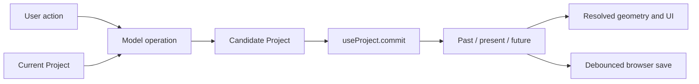

# State, editing transactions, and persistence

[Documentation index](README.md)

The editor keeps a serializable `Project` in React state and passes immutable replacements through one history hook. Selection, camera controls, dialogs, drafts, and geometric previews live outside that project. This boundary is what makes an accepted edit undoable and autosaved while a canceled preview leaves the saved construction unchanged.

The main entry points are [App.tsx](../src/App.tsx), [use-project.ts](../src/hooks/use-project.ts), and the [project types](../src/lib/types.ts). Geometry and assembly relationships are described in [Domain model and geometry](domain-model-and-geometry.md).

## State ownership

| Owner | State and responsibilities | Saved with a project? |
| --- | --- | --- |
| `useProject` | Current project, past/future snapshots, repeat-group token, save status, startup repair notice | Current project only |
| `App` | Panel and connector selections, inspector/list tabs, dialogs, new-panel draft, attachment options, camera-view choice, sidebar visibility, exploded/realistic preview switches, context menu, notifications | No |
| `useAssemblyEditor` | Which instance is being edited, assembly placement mode, hovered placement target | No |
| `useCopyPaste` | In-memory copied panel/assembly, insertion candidates, hovered candidate | No |
| `usePreviewDrag` / `usePreviewResize` | Gesture source, latest candidate project, transient displayed geometry | No |
| `useAttachmentPreview` | Derived candidate project, preview panels/hardware, validation issues | No |
| Local form components | Unapplied outline, parameter, color, and field drafts | No |
| `App` snap settings | Grid/geometry snapping flags, spacing, tolerance | Separate browser preference |

The `Project` includes user-visible organization as well as geometry: names, panel visibility/order, connector order, list groups, custom palette colors, and per-piece connector overrides. Those edits go through history just like resizing a panel. Flat list groups are independent of physical assembly membership.

`App` derives resolved panel transforms with `resolvePanels(project)`, physical hardware with `orderedConnectors(project)`, and warnings/errors with `validateProject(project)`. These are derived views of the project rather than additional persisted stores. There is no Redux/Zustand store or server synchronization layer.

## A committed edit



`commit` accepts either a complete `Project` or a function from the current project to the next project. Functional updates are especially important for commands that may arrive faster than React renders, such as held movement keys.

In [use-project.ts](../src/hooks/use-project.ts):

1. A `latest` ref holds the newest history synchronously. `changeHistory` evaluates an operation against that ref and updates it before scheduling the React state update. A second command therefore does not solve geometry against a stale render.
2. `ensureProjectPalette` adopts missing panel finish colors into the custom palette.
3. A JSON-equal project is a no-op: it creates neither a history entry nor a new present value.
4. An ordinary commit appends the previous present to `past`, keeping at most 60 past snapshots, and clears `future`.
5. `{ group, repeat }` can fold successive commits into one undo step when `repeat` is true and the group matches. Panel and connector keyboard movement use separate group names. The first non-repeat event starts a new step.

History stores complete project snapshots, not commands or geometry diffs. Mutating an earlier project object in place would corrupt both undo and preview comparisons; model operations must preserve prior snapshots. `commit` itself is not a universal geometry validator: callers and domain operations enforce the relevant constraints before accepting a candidate. Exceptions from an operation propagate synchronously to the caller, where UI flows generally catch them and show a message without replacing the project.

Undo moves the current project to the front of `future` and restores the last past snapshot. Redo reverses that movement. Both reset the repeat-group token and trigger autosave of the restored project. Selection and camera state are not part of these snapshots; effects remove selections whose IDs no longer exist.

Starting a blank project, applying a template, and importing a project also use `commit`. They replace the current construction without clearing the in-memory undo stack. That allows Undo to restore the previous project until the page is reloaded. New-project and template replacement confirmation UI is coordinated through `App` and [ProjectDialogs.tsx](../src/components/ProjectDialogs.tsx).

## Preview and draft transactions

### Panel attachment

[use-attachment-preview.ts](../src/hooks/use-attachment-preview.ts) derives a complete candidate using `attachPanel` or `attachExistingPanel`, resolves its transforms, and identifies changed or newly added panels. It also selects connections needed to render the ghost and validates issues involving preview panels. The Apply action is enabled only when a candidate exists and its attachment errors are empty. Applying commits the candidate once; changing side, count, angle, or draft dimensions only recalculates the preview.

### Dragging and resize handles

[use-preview-drag.ts](../src/hooks/use-preview-drag.ts) prepares a drag session from the source project. Pointer movement computes candidates with the geometry/snap helpers in [preview-drag.ts](../src/lib/preview-drag.ts) and [preview-snap.ts](../src/lib/preview-snap.ts). React state makes the candidate visible, while a ref retains the latest result for pointer release. The hook only displays or commits a candidate while its original project is still the current project. A canceled gesture discards its candidate; an accepted gesture commits once. Dragging can also finish with a supported attachment candidate.

Control-drag preparation releases joints crossing the selection boundary in the candidate while preserving the construction's world poses and internal joints. It then translates the selection and can fit new attachment hardware. This differs from keyboard movement and connected resize, which solve changes while preserving the existing joints. Canceling a drag restores the original connections because the released construction was never committed.

[use-preview-resize.ts](../src/hooks/use-preview-resize.ts) follows the same pattern with a prepared resize source, selected handle, and optional independent-panel mode. It verifies that the gesture still refers to the current prepared source. Distances pass through snapping and [preview-resize.ts](../src/lib/preview-resize.ts), which can return a size-limited result. Release commits a nonzero valid result once; Escape/cancel restores the committed view. Transient resize projects never enter autosave.

`App` supplies the active resize/drag project to the workspace, otherwise the committed project. Insertion and attachment previews add ghost panels/connections and suppress hardware or panels that the candidate replaces. An apparently changed connector during hover is therefore not necessarily a saved edit.

### Insertion and assembly placement

[use-copy-paste.ts](../src/hooks/use-copy-paste.ts) holds candidate projects alongside the project reference and selection signature used to generate them. A project or selection change invalidates that placement. Hover selects a candidate for display; clicking a target commits it once. Cancellation has no project side effects.

[use-assembly-editor.ts](../src/hooks/use-assembly-editor.ts) similarly generates corner-attachment candidates and ties the hovered target to the source project reference. Its preview identifies added/moved panels, changed hardware, and suppressed original hardware. Committing a placement includes the necessary shared-joint changes in the same undo step.

### TROFAST placement drafts

[`TrofastInspector.tsx`](../src/components/TrofastInspector.tsx) holds a new or edited insert locally. Item, color, turn, and center controls update the panel diagram and a candidate scene panel, without changing the committed project. `App` ties this preview to the current project identity and selected panel and suppresses it during conflicting modes. Apply uses a functional project commit with clearance validation; Cancel, Escape, selection changes, or unmount discard the preview. Existing inserts remain editable/removable from the panel inspector. Shared assembly edits use the definition API and validate every rebuilt instance. Undo/redo, autosave, project files, standalone assemblies, and panel duplication retain the nested data.

### Local form drafts

Several forms intentionally have a narrower transaction boundary than the project:

- [PanelOutlineEditor.tsx](../src/components/PanelOutlineEditor.tsx) owns its own draft history, points, radius, zoom, pan, and snapping. Apply sends one panel patch; Cancel discards the draft. Its local Undo does not undo project history.
- [AssemblyParametersEditor.tsx](../src/components/AssemblyParametersEditor.tsx) edits a parameter draft until Save values invokes the shared-design update. Cancel discards that draft.
- [PaletteManager.tsx](../src/components/PaletteManager.tsx) edits a color locally and calls the project palette callbacks only on Save. Those callbacks can replace uses of that color across panels, definition panels, and instance finish overrides.
- [fields.tsx](../src/components/fields.tsx) supports fields whose numeric drafts commit on blur/Enter, avoiding partially typed dimensions becoming geometry operations.

## Selection and editing modes

Panel selection uses panel IDs. Physical connector selection uses the serialized ID for a connection and placement index, as defined by [connector-selection.ts](../src/lib/connector-selection.ts). A connection can produce several independently selectable pieces of hardware.

Ordinary panel selection clears connector selection, and ordinary connector selection clears panel selection. Additive canvas selection and box selection can keep both. When both exist, the active Panels/Connectors tab determines which inspector is shown. The two selections remain separate arrays; do not infer the full selection from one array or from the active inspector.

Outside shared-design editing, selecting an assembly member normally selects every panel belonging to that instance. Box selection expands hits to whole linked instances. During shared-design editing, box selection is restricted to that instance's panels and internal connectors. A drilled-in member selection is distinct from a whole-instance selection, and actions such as duplicate/remove require the whole instance.

`App` coordinates mode restrictions: dialogs, attachment mode, clipboard placement, dragging/resizing, exploded view, and shared-design editing can disable conflicting operations. Keyboard handlers also respect text inputs, editable content, dialog focus, composition events, and already handled events. Canvas movement has additional focus/navigation handling in the preview components. Preserve these boundaries when adding shortcuts so field editing cannot accidentally mutate the construction.

## Shared assembly editing

An assembly instance references a reusable definition and maps definition-local panel IDs to materialized project-panel IDs. [use-assembly-editor.ts](../src/hooks/use-assembly-editor.ts) translates the selected project IDs back to definition part IDs before calling `updateAssemblyDefinition`.

The principal paths are:

| Action | Model operation | Effect |
| --- | --- | --- |
| Edit shared panel properties | `updateAssemblyDefinition` | Changes the reusable source and rebuilds linked instances |
| Save exposed controls | `updateAssemblyParameters` | Changes the shared parameter definition |
| Change instance dimension value | `updateAssemblyParameterValues` | Changes that instance's parameter override |
| Reset instance dimensions | `resetAssemblyParameterValues` | Restores source defaults |
| Change/reset instance appearance | `updateAssemblyFinish` / `resetAssemblyFinish` | Changes the instance override, including independent color/coverage reset |
| Make independent | `makeAssemblyIndependent` | Gives an instance a separate source while retaining physical links |
| Disassemble | `disassembleAssembly` | Removes instance membership while retaining editable panels and physical joints |

These operations live in [assemblies.ts](../src/lib/assemblies.ts) and its supporting parameter/rescale modules. The hook's `run` wrapper commits a successful model result and catches rejected operations. A shared editing session is a UI mode, not one long transaction: accepted edits commit as they occur. Done editing leaves that mode and selects the whole instance. Only a form with an explicit local draft, such as Editable values, waits for Save.

Selecting hardware leaves shared-source editing because connector changes apply to materialized instance hardware. Directly changing assembly member panels in the project would bypass the definition, instance mappings, and shared-link rebuild logic.

## Browser persistence

| Storage | Key | Contents and lifecycle |
| --- | --- | --- |
| `localStorage` | `playwood-studio-project-v1` | One serialized current `Project`; read at startup, saved 400 ms after the latest present change, and flushed on `pagehide` |
| `localStorage` | `playwood-snap` | Grid/geometry flags, spacing, and tolerance; read by `readSnapSettings`, written when settings change |
| `sessionStorage` | `playwood.build-guide.position.v1` | Guide ID and step, validated and restored by [BuildGuide.tsx](../src/components/BuildGuide.tsx) |

Keep the project storage key stable when changing branding or UI wording. It is intentionally older than the displayed app name. Persistence is browser/origin-local; project files are the portable representation. No account, remote database, or history synchronization is involved, and no cross-tab storage-event reconciliation is implemented.

An unavailable or malformed project store falls back to `createStarterProject('shelf')`, allowing the editor to open. A failed save sets `Storage unavailable · export to save`; other optional preference stores fail silently. Only the present project is persisted, so undo history, clipboard contents, selections, and transient modes disappear on reload.

Snap settings are validated on read: grid/geometry require explicit `true`, spacing is clamped to 1–1000 mm, and tolerance to 1–100 mm. Defaults are both snap modes off, 50 mm spacing, and 10 mm tolerance. Grid visibility is a separate unsaved UI toggle.

[InspectorPrimitives.tsx](../src/components/InspectorPrimitives.tsx) remembers disclosure expansion in a module-level `Map`. It survives component remounts in the current page session, but it is neither browser storage nor project data.

## Project files and import validation

Project export downloads the current `Project` as indented JSON, named from the project title with a `.playwood.json` suffix. The schema is [Project in types.ts](../src/lib/types.ts):

```text
Project
  version: 1
  name
  panels[]           optional panel-local trofastInserts[]
  connections[]
  assemblies?         definitions, instances, physical links, loose ports
  customColors?       named panel finish swatches
  connectorOverrides? per-piece color/type/material/removal/slide
  listGroups?         flat panel/connector groups
  connectorOrder?     physical connector ordering
```

The UI rejects files larger than 2,000,000 bytes before reading them. `JSON.parse` is followed by [parseProject in model.ts](../src/lib/model.ts), which constructs a validated object rather than treating a type assertion as validation. Its responsibilities include:

- Version and required arrays; at most 200 panels and 400 connections.
- Finite numeric ranges, supported enums, unique IDs, six-digit hex colors, vector shapes, boolean flags, custom outline validation, and perforation spacing/count limits.
- Connections referring to distinct existing panels, at most one driving parent per child, valid multi-branch joint structure, and no cycles in the driving attachment graph.
- Optional palette parsing and assembly metadata validation.
- Well-formed per-piece override keys/values. Removed hardware is represented by an override, not by deleting the structural joint.
- Valid list groups/order, with stale or duplicate item references filtered out instead of recreating deleted parts.

`parseProject` checks serialized structure and topology; it does not run every warning/error check in `validateProject`. The latter produces the editor's geometric diagnostics. Do not assume that parsing a document means every physical joint, overlap, or fabrication constraint has passed.

Assembly metadata has an additional consistency boundary. [parseAssemblyData](../src/lib/assemblies.ts) parses definitions through the project parser, checks ports, parameters, instance mappings/overrides, and link endpoints, then rebuilds the assemblies and compares their materialized panels/connections with the saved project. A valid definition cannot be paired with inconsistent cached instance geometry and silently accepted. Numeric and rotation comparisons allow the small tolerances used by that implementation.

When adding a persisted property, consider all relevant paths: type definition, model creation/update, parser and backward-compatible defaults, assembly definitions/instances where applicable, export, copy/clone behavior, and representative round-trip tests. The exported JSON currently has version `1`; optional properties provide several compatibility paths within that version.

## Compatibility repairs and defaults

Startup reads and parses the project, ensures its palette, then runs [repairLegacyShelf](../src/lib/legacy-shelf.ts) followed by [repairLegacyExampleInserts](../src/lib/legacy-example-inserts.ts), and ensures the final palette again. Repairs are prepared before the first render and initial save. If geometry changes, the normalized original is retained as the first undo snapshot and the UI shows a repair notice.

These are conservative repairs for recognized old geometry, not blanket reconstruction of user designs:

- The shelf repair recognizes the former five-panel shelf topology and replaces its embedded middle joints with the required T construction while preserving the relevant shelf poses.
- The insert repair matches known example geometry/topology and fits unchanged legacy inserts; added, removed, moved, or resized pieces opt out.

File import applies the same two repairs after parsing, then commits the repaired result as one import action. Undo of an import restores the project that was open before import; startup repair Undo restores the saved original.

Older optional fields have explicit fallbacks, including visible panels by default, zero corner radius, natural finish coverage when omitted, and plastic connector material. Palette parsing also accepts the earlier array of unnamed hex swatches. `ensureProjectPalette` adopts unlisted panel colors from project panels, assembly definitions, and instance finishes, preserving their visible colors. It runs at startup and on every commit.

## Reusable assembly files

[assembly-file.ts](../src/lib/assembly-file.ts) defines a separate file envelope:

```text
{ format: "playwood-assembly", version: 1, definition: AssemblyDefinition }
```

Assembly exports use `.playwood-assembly.json`. `createAssemblyFile` evaluates the selected instance's parameter values, makes those values the exported parameter defaults, applies its finish overrides to exported panels, and uses its instance name. It exports reusable local construction, ports, and editable controls rather than the full project placement, neighbor links, UI state, or per-piece project hardware overrides.

`parseAssemblyFile` checks the format/version, reuses `parseAssemblyData` for the definition, assigns a fresh definition ID on every import, requires at least two panels, and instantiates the definition in an empty project to check evaluated geometry. Thus repeated imports create independent reusable designs. A full project file must use project import instead.

The assembly import UI uses the same 2,000,000-byte limit. With an eligible panel/assembly selection, it offers insertion previews; the imported definition becomes project state only when placement is accepted. With no panel target (or while inspecting connectors), it inserts a new instance directly. In either case the accepted insertion is one ordinary commit.

## Clipboard and CSV export

Copy/paste is internal to the current app session; [use-copy-paste.ts](../src/hooks/use-copy-paste.ts) does not use the operating-system clipboard API. [clipboard.ts](../src/lib/clipboard.ts) clones one resolved panel or one whole assembly. Assembly copies retain their definition ID and use the existing source when it remains available; if that source was removed, the captured definition can be restored. Paste requires a target and offers validated attachment candidates. Reloading loses this clipboard.

`projectToCsv` in [model.ts](../src/lib/model.ts) is a parts/cutting-list export, not an importable project format. It writes one row per project panel and groups installed physical connectors by type, material, and display color. Panel rows include dimensions, finish coverage, perforation information, radius, and custom-outline coordinates converted to millimeters. It uses a UTF-8 BOM, CRLF lines, quoted/escaped cells, and prefixes formula-like string values to avoid interpreting user names as spreadsheet formulas.

`panel-svg.ts` exports individual panel cutting SVGs from the Export dialog, without changing the project file format. Eligibility includes perforations, TROFAST inserts, custom outlines, and rounded corners. Each SVG uses explicit millimeter dimensions, top-left panel coordinates, closed paths with circular arcs, black outside contours, and white inside cuts. Names are XML-escaped; filenames include the project panel index to distinguish duplicate names. All materialized project panels, including hidden panels, participate. Tool offsets and depths are set by the cutter operator; TROFAST cut profiles remain approximate.

## Relevant regression coverage

The state boundary is exercised through model tests and browser flows. Useful starting points are [editor.spec.ts](../tests/editor.spec.ts), [new-project.spec.ts](../tests/new-project.spec.ts), [preview-drag.spec.ts](../tests/preview-drag.spec.ts), [preview-resize.spec.ts](../tests/preview-resize.spec.ts), [copy-paste.spec.ts](../tests/copy-paste.spec.ts), [assembly-files.spec.ts](../tests/assembly-files.spec.ts), [assembly-parameters.spec.ts](../tests/assembly-parameters.spec.ts), and the [palette](../tests/custom-colors.spec.ts), [list-group](../tests/list-groups.spec.ts), and [box-selection](../tests/box-selection.spec.ts) suites. Parser and round-trip cases also live in [model.test.ts](../src/lib/model.test.ts), [assembly-file.test.ts](../src/lib/assembly-file.test.ts), and the assembly tests under `src/lib`.
